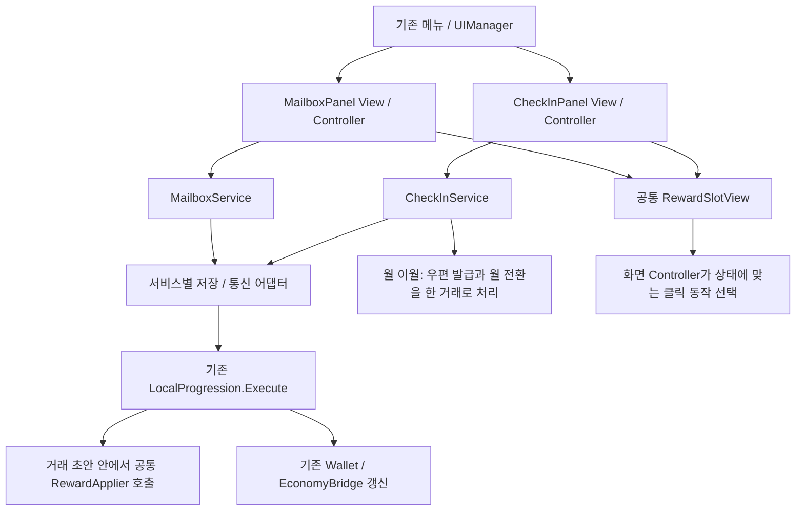

# UGUI 구조

공통 작업·아트·기기 검증 규칙은 [AGENTS.md](../../AGENTS.md)를 따른다.

## 코드와 에셋

| 위치 | 역할 |
|---|---|
| `Prefabs/Screens`, `Panels`, `Popups`, `Overlays`, `Huds`, `Items` | 인스펙터에서 편집하는 화면과 반복 위젯 |
| `Scripts/Core/UIManager.cs` | 화면·패널 스택, 뒤로가기, 토스트 |
| `UIViewCatalog.asset` | 프리팹·폰트·SFX·아이콘 참조 |
| `Scripts/Views/*Controller.cs` | 데이터 바인딩·사용자 동작 |
| `Scripts/Hud` | 파티·목표·전투 표시 |
| `Scripts/Bridges` | 씬 로딩·전투·UGUI 연결 |
| `Scripts/Core/UguiTheme.cs` | 공용 색·기준 치수 |
| `Editor` | 프리팹 생성·부분 마이그레이션·검증 |
| `Art/Font/Galmuri11 SDF.asset` | UI 기본 폰트 |

## 실행·수정

`bootstrap → UGUI_UIRoot(DontDestroyOnLoad) → SafeArea → 화면/패널/팝업/오버레이`.
`LoadManager → SceneRoutingBridge → UIManager.ReplaceScreen`, 탐색은 `PushPanel`을 사용한다.
화면 치수는 1080px 기준이며 실제 CanvasScaler·SafeArea는 루트 프리팹에서 확인한다.

프리팹을 직접 수정하거나 대상 프리팹만 마이그레이션한다. **Generate All은 수동 편집을 덮어쓰는 초기 뼈대 생성기**다.
새 위젯은 View 참조 → Items 프리팹 → UIViewCatalog 참조 → 컨트롤러 데이터 바인딩 순서로 추가한다.
목록 생성은 패널을 열 때 수행한다. 큰 목록은 가상화·풀링을 검토한다.

## 공통 연출과 기능 안내

`bootstrap/GameManager → Direction.GameDirectManager → FeatureGuidePlayer → UguiFeatureGuideSurface → FeatureGuideView`로 실행한다. Manager는 큐·저장·계정 수명을 소유하는 MonoBehaviour이고 Player와 화면 연결부는 일반 C# 클래스다. 실제 프리팹 참조·레이아웃·입력 필터는 MonoBehaviour View가 담당한다.

`Assets/_Project/Data/Direction/`의 `guide_development`, `guide_kingdom_army`, `guide_dungeon`, `guide_gacha`, `guide_mage_tower`는 독립 실습 SO다. 육성은 공격력 1회 강화, 왕국군은 대표 캐릭터의 종합·장비·전직 정보 열람, 던전은 입장 없는 정보 열람, 뽑기는 장비·마탑 스킬 각각 1회 실습이다. 기존 `first_start_menus`와 `first_reincarnation_guide`도 설명형으로 유지한다. 이전 설명형 완료를 새 실습 완료로 이관하지 않는다.

```csharp
// SO를 직접 전달하면 카탈로그 등록 없이도 요청할 수 있다.
bool accepted = Direction.GameDirectManager.Instance.RequestPlay(sequenceSO);
// ID 호출은 bootstrap의 sequences에 SO를 등록해야 한다.
Direction.GameDirectManager.Instance.RequestPlay("guide_development");
```

반환값은 접수 여부이며 완료 여부가 아니다. 동일 ID가 실행·대기 중이거나 이미 완료·건너뛰기 상태이면 거절하며 `LastError`로 이유를 제공한다. 다른 ID는 FIFO로 진행한다. `CancelCurrent()` 또는 실습의 ‘나중에 계속’은 완료·건너뛰기를 기록하지 않는다. 설명형만 `preview:true`로 저장 없이 반복할 수 있으며 실습형 preview는 거절한다.

### 데이터와 완료 조건

`Create → KingdomIdle → Direction → Sequence`로 SO를 만든다. 계정 저장에 사용하는 sequence ID와 각 단계 ID는 출시 후 다른 의미로 재사용하지 않는다. 단계에는 제목·본문·대상·배치, `context`(필요 화면), `completion`(Confirm/Click/Action), 클릭 이후 `destination`, `allowedTargets`, `allowScroll`을 설정한다. Action은 AttackOnce/EquipmentPullOnce/SkillPullOnce 중 하나다. `grantPracticeCoins`는 두 뽑기 Action에만 설정한다. 기존 SO의 추가 필드 기본값은 설명 확인/Main으로 호환된다. 본문의 `{dailyTickets}`는 실제 던전 카탈로그 값으로 치환한다.

- Confirm: 안내 카드 확인으로 완료한다. 지정한 스크롤만 허용할 수 있다.
- Click: 기존 실제 버튼을 누르고 목적 화면이 열린 것을 확인한다.
- Action: 기존 강화·뽑기 거래가 저장된 후 완료한다. 뽑기는 결과 창의 확인 버튼도 직접 누른다. 최대 강화 상태는 설명 확인으로 대체한다.

`FeatureGuideAnchor.Bind`로 컨트롤러가 동적 UI를 등록한다. Anchor는 자기 RectTransform만 해제해 늦은 Destroy가 새 등록을 지우지 않는다. 새로운 기능 대상은 대상 ID, 컨트롤러 등록, 화면 문맥 복원을 함께 추가한다. SO에 하이어라키 경로나 임의 메서드명을 저장하지 않는다.

### 저장과 입력 수명

장비 안내의 `ArmyEquipment`는 길이가 가변적인 콘텐츠가 아니라 실제 `ScrollRect.viewport`를 등록한다. View는 활성 조상 `RectMask2D`와 강조 영역을 교차해 화면 밖 콘텐츠가 전장까지 강조되지 않게 하며, 뷰포트 안내에서는 스크롤 위치를 자동으로 이동하거나 테두리를 확대하지 않는다.

`guide_mage_tower`는 **실제 마탑 탭 → 스킬 목록 → 장착 버튼 설명 → 해제 버튼 설명**의 네 단계다. `RequestPlay("guide_mage_tower")`로 요청하거나 `GameTest → Guide Test/실제 계정 저장/5 마탑 스킬`에서 실행한다. 장착·해제 실습은 요구하지 않으며 보유 스킬이 없어도 설명 확인으로 완료한다. `MageTower` 문맥은 기존 스킬 팝업을 정상 진행 화면으로 인정하고 미확인 단계 재개 시 복원한다. 마지막 확인 또는 건너뛰기 후에는 팝업을 닫는다. 진행 기록만 저장하며 스킬 소유·장착·재화는 변경하지 않는다. 에셋 누락 복구는 `KingdomIdle/Direction/Prepare mage tower guide`로 가능하다.

안내 진행은 `Modules["game-direct:" + sequenceId]`, 실습 성공은 `Modules["game-direct-action:" + sequenceId + ":" + stepId]`에 분리 저장한다. 강화·뽑기의 `Execute` 거래 초안에 성공 영수증을 함께 넣으므로 소비 직후 종료되어도 재소비하지 않는다. 안내 JSON 저장은 성공 영수증을 덮지 않는다. 주화 지급은 `Claims`의 안내 ID·Action별 키와 50개 지급을 같은 거래에 저장한다. 이미 지급한 주화는 중단 시 회수하지 않으며 추가 지급도 없다. 저장 실패는 초안을 확정하지 않고 안내 입력을 해제한다. 계정 전환은 이전 요청·대기열·지연 콜백을 무효화한다. 환생으로 초기화하지 않는다.

`FeatureGuideInputGate`는 실제 최상단 레이캐스트 대상이 허용 버튼인지 검사한다. 밝은 구멍 안이라고 모든 터치를 통과시키지 않는다. 설명 카드와 지정된 읽기 스크롤 외 조작은 막고, 버튼 복제·부모 이동·경제 처리 대체는 하지 않는다. 필요한 패널·결과 팝업은 안내 흐름에 포함하며 무관한 모달·로딩에서는 숨기고 입력 차단을 해제한다. 돌아오면 미확인 단계의 화면을 복원한다. 자동 전투 시간 배율은 변경하지 않는다. 뒤로가기는 건너뛰기이며 정상 완료 후 메인 화면으로 돌아간다.

### 직접 실행과 검증

bootstrap부터 Play하고 메인 화면에 진입한다. `GameTest` 컴포넌트의 `Guide Test/실제 계정 저장`에서 다섯 개를 각각 또는 순차 요청한다. 실제 계정 결과가 저장되므로 완료 후 다시 실행되지 않는 것이 정상이다. 환생 설명은 별도 미리보기 메뉴로 확인한다. 에셋 연결 복구는 편집 모드 `KingdomIdle/Direction/Prepare interactive guides`를 사용하며 기존 SO의 수동 편집은 덮어쓰지 않는다.

`KingdomIdle/Direction/Validate isolated guide acceptance`는 빈 PlayMode 씬·격리 계정·실제 프리팹·EventSystem 입력으로 검사하고 원래 편집 씬으로 돌아간다. 기존 안내 회귀, 다섯 안내 FIFO, 실제 강화·확률 뽑기, 중복 소비 방지, 지급·저장 실패와 재개를 검사한다. 장비 48개의 스크롤·강조 범위와 마탑 열기·재개도 검사하며 기록은 `AI/validation/game-direct-mage-20260921/`에 남긴다. 이전 네 실습 검증은 `AI/validation/game-direct-interactive-20260921/`에 보존한다. 화면 비율 캡처는 Editor 시뮬레이션이며 Android 실기기 결과가 아니다. 과거 0.15.0 검증 기록은 `AI/validation/game-direct-20260921/`에 보존한다.

자동 발생은 아직 연결하지 않는다. 다음 단계에서 신규 계정·스테이지 클리어 등의 외부 트리거가 해당 SO를 `RequestPlay`하도록 연결한다. 트리거는 게임 조건을 판단하고, 중복·완료 억제와 재개는 Manager에 맡긴다. 기존 계정에 안내 키가 없다는 이유만으로 신규 계정으로 판단하지 않는다.

`GameTest` 순차 실행은 현재 계정에서 미완료인 안내만 요청한다. 완료·건너뛰기 항목은 ID와 함께 `안내 생략` 일반 로그를 남기며 기록을 초기화하지 않는다. 패널 복원 직후 대상이 화면·마스크 밖에 있으면 `FeatureGuideView.TryRefreshLayout`은 false를 반환하고 호출자가 입력·참조를 정리한다. Player가 같은 미확인 단계를 다시 표시하므로 일시적인 레이아웃 미준비를 완료나 오류로 취급하지 않는다. 이 경계와 실제 `GameTest` 재개 경로의 회귀 결과는 `AI/validation/game-direct-visibility-20260921/`에 기록한다.

반복 실습은 PlayMode에서 `GameTest → Guide Test/실제 계정 저장/다섯 안내 테스트 기록 초기화 (재지급 허용)`를 실행한 뒤 개별 또는 순차 실행 메뉴를 사용한다. 초기화 메뉴는 실행 중인 안내와 대기열을 정리하고, 육성·왕국군·던전·뽑기·마탑의 **진행·실습 성공·체험 주화 지급 기록**을 한 번의 저장 거래로 지운다. 다음 실행에서는 강화·뽑기를 다시 수행하며 뽑기 주화 50개씩도 다시 지급한다. 현재 보유 재화·강화·장비·스킬은 유지되므로 반복 테스트 보상은 누적될 수 있다. 환생 안내와 다른 안내·퀘스트 기록은 유지한다. 이 초기화 경로는 `UNITY_EDITOR`에만 포함되며 계정 변경이나 저장 실패 시 초기화를 확정하지 않는다. 검증 기록은 `AI/validation/game-direct-reset-20260921/`에 남긴다.

## 전투 HUD

- `CompactHudBuilder.Apply`: `Screen_Main`, `Panel_Guide`, `Item_GuideStepRow`를 갱신한다.
- 메인 상단 두 줄: 재화 바 아래 `WaveHudView`의 스테이지 선택·처치 진행도, 그 아래 `GuideGoalView`의 가이드 한 줄. 클리어 스테이지에서는 선택 버튼과 `최고 스테이지 이동`만 표시한다. 기존 목표 이동·보상 수령 기능은 유지한다.
- `StageSelectPopupView/Controller`는 `Popup_StageSelect`를 카탈로그에서 열고 `StageManager.TryMoveToMainStage`로 이동한다. `CycleFrontierStage`는 이번 환생의 최고 도전 가능 위치이며 영구 클리어 기록과 분리한다. 구 저장은 현재 위치·이번 환생의 보스 클리어로 확인되는 위치만 복원한다.
- 던전은 메인 스테이지·가이드를 접고 상단에 목표·남은 시간을 표시한다. 하단 `메인 스테이지 복귀` → `Popup_DungeonReturnConfirm`의 확인에서만 기존 복귀 경로를 호출한다. 던전 결과 팝업과 자동 복귀는 기존 경로를 사용한다.
- 마탑 수동 스킬은 상단 스테이지 위치와 분리하여 우하단 왕국군 HUD 위에 유지한다. `StageBadgeAnchor`의 상단 모드는 위치를 움직이지 않고 기존 메뉴 숨김만 처리하며, 하단 던전 복귀 행은 왕국군 HUD 위에 정렬한다.
- 햄버거: 퀘스트/가이드, 가방, 설정, 반복 사냥 종료. 보스 자동 도전은 스테이지 인디케이터 옆에서 조작한다.
- `Panel_Guide`는 가이드·일일·주간·업적 네 탭을 제공한다. 상단 현재 퀘스트 카드는 가이드 탭에서만 표시하며 HUD와 같은 `QuestManager` 데이터를 쓴다.
- 하단 네 탭은 육성·왕국군·던전·뽑기. 시트가 열리면 HUD 목표 카드는 숨긴다.

`UguiPolishPass → UguiTypeNavPass`는 기존 스타일 보정 도구다. 스테이지 HUD의 부분 적용은 `StageHudPreparation.Apply`를 사용한다. `Screen_Main`과 두 신규 팝업, 카탈로그 참조만 저장하며 공용 스킨이나 다른 패널은 재생성하지 않는다.
일반 글자는 Galmuri11 기본 굵기·공유 머티리얼, 전투 숫자·컷인만 필요한 외곽선을 사용한다.
1080px 기준 패널 제목 40, 주요 버튼 30–34, 설명 26–28, 하단 라벨 30. 아이콘은 Layer Lab `PictoIcon/64` 명시 경로를 사용한다.

## 퀘스트 패널

`UIManager → GuidePanelController.Populate → BalanceQuestPanel.Bind`로 연결한다. `GuidePanelView`는 탭 부모·현재 가이드 카드·스크롤 목록의 직렬화 참조를 보관한다. 실제 패널 데이터는 `TutorialManager`가 아닌 `QuestManager.GetSnapshot(SelectedCategory)`에서 읽는다.

- 공용 `Items/Item_NavTabButton.prefab`을 패널마다 네 개 생성하고 `NavTabButtonView`로 선택 상태를 표시한다. 선택 탭이 바뀌면 기존 스크롤 목록 하나에 해당 범주만 바인딩한다.
- 최초 열기는 가이드 탭이다. 다른 패널에 덮였다 돌아오면 선택을 유지하고 최신 값을 다시 읽는다. 완전히 닫힌 패널은 파괴되므로 새로 열면 가이드부터 시작한다.
- 현재 계정 또는 선택 범주의 변경만 목록에 반영한다. 수령 완료 행은 가득 찬 게이지·낮춘 색상·비활성 `완료` 버튼으로 남긴다. 일일·주간 완료 행은 현재 기간에만 남으며, 이전 기간 미수령 보상은 수령 또는 만료 전까지 별도 기간 표시와 함께 보관한다.
- `GuideStepRowView.SetQuest`가 재화 아이콘(복수 보상 포함)·수량·종류와 내용·진행바를 표시한다. 우측 버튼은 진행 중 `이동`, 달성 시 `받기`, 수령 후 `완료`다. 수령은 표시 시 받은 `QuestClaimToken`을 쓰며 지급·저장 성공 후에만 완료 상태를 표시한다.
- `QuestNavigation`은 가이드 HUD와 카드의 화면 이동을 공유한다. 메뉴는 스택에 쌓아 복귀 상태를 보존하고 전투 목표는 패널을 닫는다. 마탑·환생은 기존 팝업을 사용하며 오프라인 수령/일괄 목표처럼 직접 이동할 화면이 없는 항목은 `진행 중`으로 표시한다.
- `CompactHudBuilder.ApplyQuestTabs`는 기존 `Panel_Guide`에 탭 컨테이너와 참조만 적용한다. 다른 HUD·공용 버튼 프리팹을 재생성하지 않는다. 구조와 학습용 설명은 `AI/quest-tabs-implementation-20260918.md`에 기록한다.

## 검증 진입점

- `KingdomIdle/UGUI/Validate/Check view wiring`: 직렬화 참조·missing script.
- `StageHudValidation.Run()`: 명시적으로 연 `balance-qa-stage-hud-*` 계정의 Editor Play에서 스테이지 선택·최고 이동·던전 복귀·환생 기록과 네 화면 크기를 검사한다. 일반 계정에서는 실행을 거절한다. 결과와 캡처는 `Recordings/StageHud20261018/`, 이번 적용 검증 기록은 `AI/validation/stage-hud-20261018/report.json`에 보관한다.
- `KingdomIdle/UGUI/Run client regression checks`: 기존 클라이언트 회귀 검사.
- `KingdomIdle/UGUI/Apply compact battle HUD`: 이번 HUD 프리팹 적용.
- `KingdomIdle/UGUI/Apply quest category tabs` / `CompactHudBuilder.ApplyQuestTabs`: 퀘스트 패널의 탭 컨테이너·직렬화 참조만 적용.
- `KingdomIdle/UGUI/Apply quest reward cards` / `QuestCardPrefabBuilder.Apply`: 기존 행 프리팹의 GUID와 참조를 보존하며 보상·진행바·행동 버튼을 연결한다. 기존 전체 생성기도 같은 업그레이드를 사용한다.
- `KingdomIdle.UGUI.Editor.QuestTabAcceptance.Run()`: 빈 검사 씬의 PlayMode에서 실제 프리팹 복제본·격리 계정으로 탭 선택, 수령 완료 유지, 재활성화, 중복 수령 방지, 기간 초기화를 검사한다. 운영 계정이 열린 씬에서는 실행을 거절한다.
- `TitleLobbyDeviceBuild.Build`: `.lobbyqa` ARM64 Development 진단 APK. `BuildForManualTesting`은 같은 패키지를 사용하면서 자동 진단·테스트 계정 주입을 제외한다. `LOBBY_QA_OUTPUT`으로 출력 위치, `DEVICE_BUILD_PURPOSE`로 용도를 지정한다. 앱·APK 이름에는 용도와 버전·빌드 번호를 넣으며 빌드마다 versionCode가 증가한다. 성공한 APK 경로와 메타데이터는 출력 폴더의 `build.json`에서 읽는다. 기기 정리·최종 설치 기준은 [프로젝트 지침](../../AGENTS.md)을 따른다.
- `BalanceEditorValidation.BuildAndroidForManualTesting`: 밸런스·저장 데이터 이관·직렬화 참조 검사를 실행하고 글리프를 준비한 뒤 직접 플레이용 APK를 만든다.
- `CompactHudBuilder.ApplyAndBuild`: HUD 적용 후 위 Android 빌드.
- `BattleHudDeviceProbe`: QA 빌드 전용 HUD 상태·레이아웃·진행 fixture. 일반 배포에는 포함되지 않는다.

Android 검사 도우미·결과는 `AI/qa/hud/`, `Recordings/HudRevision/`에 있다. `Recordings`는 Git 제외다.
퀘스트 탭 결과는 `AI/validation/quest-tabs-20260918/`에 있다. 그 안의 PNG는 실제 프리팹을 PreviewScene에서 고정 예시 데이터로 렌더한 비교 자료이며, 게임플레이 또는 Android 기기 캡처와 구별한다.

## 마탑·뽑기

`MageUiPreparation`은 10종 스킬 셀, 개화 선택이 있는 상세 창, 목재·청동 뽑기 버튼과 결과 창을 준비한다. 스킬 등급은 없으며 청동 테두리와 문구로 장착, 보라색과 아이콘 변형으로 개화를 표시한다. 스킬 셀은 재사용한다. `MageSkillPresentation`은 등록 SO와 저장 상태를 읽는다. `GachaButtonFlare`는 unscaled-time 가장자리 청색 연출을 재사용하며, 저사양에서도 결제 시점·취소 동작은 동일하다. 창을 닫으면 결제 전 연출을 취소하고 연속 터치에는 한 번만 결제한다.

마탑 Android 검증 도우미는 `AI/qa/mage/`, 상세 근거는 [통합 보고서](../../Docs/ArtPreparation/MAGE_INTEGRATION_VALIDATION.md)에 있다.

`MageManualCastHud`는 자동 시전을 끄면 장착 슬롯을 우측 스테이지 표시 위로 순서대로 펼치고 다시 켜면 대응하는 퇴장 애니메이션으로 접는다. 준비 상태는 점등하고 쿨다운은 시계 방향 음영과 남은 초로 표시한다. 탭은 자동 조준 시전, 드래그는 전투 지점 지정이다. `MagicAimGraphic`은 실제 원형 판정 반경을 쿼터뷰 타원으로 투영하고 전장 도트 크기에 맞춰 표시한다. 빈 슬롯은 숨기며 UI 위 드롭, 화면 밖, 전투 전환, 포커스 상실은 시전 없이 취소한다. 얼음 송곳과 유성우는 탭으로만 시전한다.

장비와 가방은 `VirtualEquipmentGrid`로 화면에 보이는 카드만 만든다. 보관함 초과 보상은 기존 수량형 저장 구조에 영구 보관하여 전투·던전·뽑기를 막지 않는다. `EquipmentData.DisplayName`은 화면용 이름이며 기존 저장 키와 아이템 코드는 유지한다. 상세 스탯은 실제 `PlayerStatus` 계산을 사용하고 변경된 계산식만 다시 그린다.

현재 검증 진입점은 `PlayabilityRevisionPreparation.Validate`, Unity 실행 검사 `KingdomIdle.UGUI.Editor.PlayabilityLiveValidation.Run`, Android `AI/qa/mage/playability_checks.py`다. 증거는 `Recordings/PlayabilityRevision`과 [플레이 개선 검증 기록](../../Docs/ArtPreparation/PLAYABILITY_20260918.md)에 있다.

0.11.1 후속 검증은 `PlayabilityRevisionPreparation.ValidateSessionRoutes`와 `AI/qa/mage/player_*.py`를 사용한다. 가이드 이동은 대상 탭을 한 번 지정하고, 스테이지 배지는 반복 사냥에서 다음 구간 도전을 제공한다. 프로필은 실제 진행 수치를 읽으며 던전 팝업은 짧은 웨이브 전환 동안 입장 요청을 유지하고 닫기 시 취소한다. [30분 × 3회 실플레이 기록](../../Docs/ArtPreparation/PLAYER_SIMULATION_20260918.md)에 수정과 성능 측정이 있다.

퀘스트 병합(2026-09-21): UI는 `QuestManager`의 snapshot/event를 읽고 수령은 `TryClaim`으로 요청한다. `LocalProgression`의 0.75초 스킬 자동 저장 성공 뒤 기존 변경 알림으로 갱신하며 별도 표시 타이머는 두지 않는다. 이동은 목표 ID까지 전달해 소환·장비·전직 탭을 선택한다. 프리팹 배치는 퀘스트 카드 작업본을 유지하고 외부 에셋 참조는 프로젝트 내 작업본으로 연결한다.

## CheckIn·우편함 구현 설계

2026-10-25 기획 변경을 반영한 **구현 전 설계**다. 이 절은 이전의 누적 28일 완료 후 초기화, 수령해야 출석 진도 증가, 우편 수령 즉시 삭제 설계를 대체한다. 신규 클래스·프리팹·API는 제안 이름이며 아직 구현되지 않았다. 출석의 영문 명칭은 `CheckIn`을 사용한다. 광고 SDK·광고 보상 정책은 이번 범위에 포함하지 않는다.

### 확정 요구와 처리 경계

| 항목 | 동작 |
|---|---|
| 월간 출석 | 한국시간 매월 1일 00:00에 새 출석부. 해당 월의 누적 접속일수 최대 28일 |
| 일차 의미 | 실제 달력 날짜가 아님. 10월 5일 처음 접속하면 그달 1일차부터 시작 |
| 출석 인정 | 보상 수령과 관계없이 접속 날짜를 기록. 같은 한국시간 날짜에는 한 번만 기록 |
| 미수령 유지 | 출석으로 열린 보상은 월 안에서 계속 보관. 다음 접속일에는 다음 일차도 활성화 |
| 28일 이후 | 같은 월에는 29일차나 새 주기를 만들지 않음. 기존 미수령 보상은 계속 받을 수 있음 |
| 월초 미수령 | 지난달 실제 출석으로 열린 미수령 보상만 우편으로 이전. 미출석 슬롯은 지급하지 않음 |
| 출석 화면 | 7열 × 4행, 스크롤 없는 한 페이지. 셀 상태 문구·상단 일괄 수령 설명·하단 범례와 받기 버튼을 제거하고, 하단은 `다음 보상까지 HH : MM : SS` 한 줄만 표시 |
| 활성 슬롯 클릭 | 현재 월의 수령 가능한 미수령 출석 보상을 일괄 수령 |
| 우편 수령 | 보상 지급 후 같은 UI 프레임과 내용을 유지하고 수령 완료 상태로 변경 |
| 우편 하단 | `모두 받기`와 `수령한 우편 삭제`를 별도 버튼으로 제공 |
| 우편 삭제·만료 | 명시 삭제는 수령한 우편만 대상. 수령 여부와 무관하게 만료되면 목록에서 제거 |
| 모두 받기 | 고정한 대상 전체의 보상 지급·수령 상태를 함께 확정. 일부 성공 없이 전체 성공/취소 |

한국시간 날짜·월 경계는 서버 시각을 기준으로 판정한다. 기기 시계는 표시 보조이며 로컬 검증 구현은 주입 가능한 시계를 사용한다. 월초 초기화는 모든 보상 수령 여부와 무관하며 환생과도 무관하다. 화면을 그리는 `GetSnapshot()` 자체는 출석 기록이나 저장을 수행하지 않는다.

월 이월은 현재 월 키가 저장 월 키보다 앞으로 갔을 때만 실행한다. 과거 월 응답이나 로컬 테스트 시계 역행으로 출석부를 이전 월로 되돌리거나 이월 우편을 다시 만들지 않는다.

`다음 보상까지 HH : MM : SS`는 다음 갱신 시각까지 남은 시간을 초 단위로 표시한다. 기준은 28일 미만이면 다음 한국시간 자정, 28일을 모두 기록했으면 다음 달 1일 00:00으로 유지한다. 시간은 24시간을 넘을 수 있는 총 남은 시간이며 음수로 표시하지 않는다. 월초에는 새 출석부와 미수령 이월 처리가 함께 반영된다. 출석 보상 수치와 이월 우편의 유효기간은 운영 설정으로 확정해야 하며 시안 값이나 임의의 기간을 출시 정책으로 사용하지 않는다.

### 역할 분리와 의존 방향



`CheckInService`와 `MailboxService`는 독립된 일반 C# 클래스다. 공통 보상 표시·지급기를 공유하지만 출석 기록·월 이월·우편 만료 정책을 하나의 서비스로 합치지 않는다. 도식의 저장/통신 어댑터도 같은 계층을 묶어 표현한 것이다. 월 이월은 두 서비스를 서로 호출하게 만들지 않고 저장 계층의 한 거래에서 CheckIn 상태와 우편 저장을 함께 변경한다.

`GameManager.Init()`의 기존 서비스 구성 방식에 맞춰 서비스를 생성·소유한다. 계정 준비, 앱 복귀, 접속 중 날짜 경계는 얇은 수명 연결부에서 `RecordVisitAsync()`와 상태 동기화로 전달한다. 출석 패널을 열지 않아도 출석이 기록되어야 한다. 계정 준비 전 임의의 guest 상태를 열지 않으며 `AccountChanged`와 `AccountGeneration`으로 이전 계정의 캐시·콜백을 무효화한다.

### 신규 상태·메서드

도메인은 `Assets/_Project/Scripts/CheckIn/`, `Mailbox/`, `Rewards/`, UI는 기존 `Assets/UGUI/Scripts/Views/` 및 `Views/Items/`를 사용한다. 실제 생성 시 기존 namespace·asmdef 경계를 따른다.

| 제안 구성 | 데이터·메서드 | 책임 |
|---|---|---|
| `CheckInState` | `MonthKey`, `CheckedInCount`(0–28), `LastRecordedDayKst`, `ClaimedSlotIds`, 보상 명세/버전 | 출석 인정과 보상 수령을 별개로 저장 |
| `CheckInRewardTableSO` | 월/보상 버전, 1–28일 보상 정의 | 표시·로컬 검증용 정의. 서버 지급 정의와 버전 대응 |
| `CheckInClaimToken` | 계정 세대, 월 키, 고정 미수령 슬롯 ID, 보상 버전 | 다른 월이나 새로 열린 슬롯으로 대상이 바뀌지 않도록 보호 |
| `CheckInSnapshot` | 월, 출석 수, 28개 슬롯 상태, 받을 슬롯, 다음 갱신 UTC | 읽기 전용 UI 데이터 |
| `CheckInService` | `RecordVisitAsync`, `RefreshAsync`, `GetSnapshot`, `TryClaimAvailableAsync`, `Changed` | 접속 기록·월 동기화·일괄 수령 조정 |
| `CheckInRolloverRecord` | 계정, 이전 월, 출처 슬롯 키, 생성 우편 ID | 월 이월 중복 방지. 우편 삭제 후에도 보존 |
| `MailMessage` | 고유 ID, 제목/발신자/본문, 생성·만료 UTC, 보상 명세, 버전, `ClaimedAtUtc`/영수증 ID | 미수령과 수령 완료 우편을 함께 보관 |
| `MailboxSnapshot` | 미만료 우편 전체, 미수령 대상, 수령한 삭제 대상 | 표시 목록과 수령·삭제 대상 분리 |
| `MailClaimToken` / `MailDeleteToken` | 계정 세대, 대상 ID·개별 버전 | 지급 요청과 삭제 요청을 구분 |
| `MailboxService` | `GetSnapshot`, `RefreshAsync`, `TryClaimAsync`, `TryClaimAllAsync`, `DeleteClaimedAsync`, `Changed` | 조회·만료 정리·전체 수령·수령 우편 삭제 |
| `RewardGrant` / `RewardItemRef` | 종류, 기존 식별자, 양수 long 수량 | 저장/전송용 보상 명세. Sprite·GameObject 참조 없음 |
| `RewardApplier` | `TryApply(ProgressionState draft, grants)` | 승인된 전체 보상을 거래 초안에 반영. 자체 저장·통신·기간 정책 없음 |
| `ClaimReceipt` | 요청 ID, 출처 키, 확정 보상·시각·서비스 버전 | 중복 지급 방지와 확정 결과 복구 |
| `ClaimResult` | 상태, 원인, 영수증, 최신 snapshot | 성공/미지급 확정/결과 확인 중/로컬 반영 대기 구분 |
| `RewardPresentationResolver` | `Resolve(RewardItemRef)` | 기존 아이콘·이름·짧은 설명을 공통 표시 데이터로 변환 |

출석 슬롯의 논리 상태는 `Locked`, `Claimable`, `Claimed`로 유지하되 셀에 `예정`·`받기`·`완료` 같은 상태 문구를 표시하지 않는다. 받을 수 있는 슬롯만 강조하고 수령한 슬롯은 기존 체크 표시로 구분한다. 현재 월의 열린 슬롯은 1부터 `CheckedInCount`까지이고, `Claimable`은 그중 `ClaimedSlotIds`에 없는 슬롯이다. 실제 달력 날짜가 비어도 중간 일차를 건너뛰지 않는다. 슬롯별 보상 명세를 보존하여 운영 보상표 변경이 이미 열린 보상이나 이월 내용에 소급 적용되지 않게 한다.

`GetSnapshot`은 저장·네트워크 호출 없이 마지막 확정 상태를 읽는다. `RecordVisitAsync`와 `RefreshAsync`의 명령 수명은 패널보다 길다. `ICheckInBackend`, `IMailboxBackend`로 로컬 검증 구현과 실제 서버 구현을 교체하고, 서버 실패 시 로컬 지급으로 대체하지 않는다. 비동기 연결은 기존 UniTask/콜백 패턴을 따른다.

`ProgressionState`에는 월간 출석 상태, 수령 완료를 포함한 우편 목록, 월별 이월 원장, 영수증과 pending 요청을 명시적 타입으로 추가한다. `DeepClone()`의 깊은 복사, `Open()`의 기존 저장 기본값/이관, `Validate()`의 월·일수·슬롯 범위·중복·양수 수량 검사에 모두 반영한다. 임의 JSON을 `Modules`에 넣어 서로 다른 수명을 섞지 않는다. 기존 계정을 새 최상위 Schema로 무조건 거절하지 않도록 이관을 함께 설계한다.

일반 재화는 기존 `eCurrency`를 사용한다. 장비 지원 시 기존 코드/인스턴스 규칙과 `EquipmentManager.Grant(..., allowPending:true)`를 사용하고, 미지원 보상을 생략한 채 성공시키지 않는다. `RewardApplier`는 checked 합산을 사용하며 실패한 초안을 원본에 노출하지 않는다. 전투로 계속 증가하는 전역 `Revision` 대신 해당 월·슬롯·우편의 자격과 버전만 비교한다.

### 접속 기록·월초 이월·출석 수령

1. 로그인 후 계정 준비, 앱 복귀, 접속 중 한국시간 날짜 경계에서 서버 기준 상태를 확인한다. 재로그인·동시 요청도 같은 날짜를 두 번 기록하지 않는다.
2. 현재 월이 저장 월과 같고 오늘이 `LastRecordedDayKst`보다 뒤라면 출석 수를 최대 28까지 한 번 증가시킨다. 결석 날짜를 추정해 여러 일차를 자동으로 열지 않는다.
3. 출석 기록 저장 성공 후 새 슬롯을 활성화한다. 이때 재화는 지급하지 않는다. 수령하지 않아도 다음 접속 날짜에는 다음 슬롯이 열린다.
4. 월이 바뀌면 이전 월의 `열린 슬롯 - 수령 확정 슬롯`을 계산한다. 그 명세를 이월 우편으로 옮기고 이월 원장과 새 월 상태를 같은 거래에 기록한다.
5. 이월할 명세가 없으면 빈 우편을 만들지 않는다. 출석하지 않은 월이나 잠긴 슬롯의 보상도 만들지 않는다. 새 월의 현재 접속일은 1일차로 기록한다.
6. 사용자가 활성 슬롯 하나를 누르면 현재 월의 미수령 슬롯 집합을 고정하고 전체 보상 수령을 요청한다. 클릭한 슬롯 하나만 받는 것이 아니다.
7. 거래에서 계정·월·대상 슬롯·미수령·보상 버전을 검증하고 모든 보상 지급, 수령 슬롯 기록, 영수증을 함께 저장한다. 하나라도 실패하면 지급과 수령 표시는 모두 취소되지만 이미 확정된 접속 기록은 유지한다.

월 이월은 **재화 지급이 아니라 보상 권리의 우편 이전**이다. 예를 들어 그달 출석 10일·수령 7일이면 8–10일차 보상만 우편으로 옮긴다. 새 월 1일차 보상과 구월 보상을 섞지 않는다. 이월 우편은 일반 우편과 같은 수령·삭제·만료 흐름을 사용한다.

계정·월별 고유 키(예: `checkin-carryover:{account}:{YYYY-MM}`)와 원장에서 중복 이월을 막는다. 이월 우편 발급, 구월 보상 권리 이전, 새 월 상태 전환 중 일부만 저장하지 않는다. 이월 우편을 수령·삭제하거나 만료시켜도 원장을 지우지 않아 같은 월의 우편을 다시 발급하지 않는다. 우편 생성·유효기간 계산은 운영 설정을 따르며 미확정 숫자를 넣지 않는다.

접속 중 월초에는 즉시 새 상태를 표시한다. 미접속 계정의 월 경계는 서버 작업 또는 다음 계정 동기화에서 확정할 수 있으나, 어떤 방식이든 다음 화면은 새 월이어야 하고 이전 월을 다시 수령 가능한 판으로 보여주지 않는다. 여러 달 미접속해도 실제 기록이 있는 이전 월의 잔여 보상만 처리한다. 구현할 서버 처리 방식과 이월 우편 만료 기준 시각은 백엔드·운영 계약에서 확인한다.

구월 직접 수령과 월 이월이 동시에 같은 슬롯 권리를 처리하지 않도록 서버의 같은 계정 거래에서 직렬화한다. 구월에 이미 확정된 수령 영수증은 응답이 새 월에 도착해도 원래 성공으로 복구하며 해당 슬롯을 이월 우편에 또 넣지 않는다. 구월 토큰을 서버가 월초 이후 처음 처리했다면 직접 수령을 거절하고 이월된 최신 상태를 반환한다.

### 우편 수령·삭제·만료

우편의 표시 상태는 `Unclaimed → Claimed`이고, 명시 삭제 또는 만료 때 표시 목록에서 제거된다. 수령 후에도 제목·본문·첨부 슬롯·원래 만료 시각과 행 프레임을 유지한다. 받기 버튼은 `수령 완료`로 비활성화하며 아이템 설명과 본문 열람은 계속 허용한다.

1. 우편함 진입 시 최신 상태를 조회하고 수령 여부와 관계없이 만료된 우편을 제외·정리한다. 로딩/오류를 빈 목록처럼 표시하지 않는다.
2. 모두 받기는 전체 목록의 미만료·미수령 우편 ID를 고정한다. 렌더된 화면/페이지의 행만 대상으로 삼지 않는다. 수령된 우편은 대상에서 제외한다.
3. 모든 대상의 계정·존재·미수령·만료·버전·보상을 한 기준 시각으로 검사한다. 요청 뒤 새 우편은 이 요청에 끼우지 않는다.
4. 모든 보상 지급, 모든 대상의 `ClaimedAtUtc`와 영수증 연결을 같은 거래에 기록한다. 우편 자체는 제거하지 않는다. 하나라도 실패하면 새 지급과 수령 표시는 전부 취소한다.
5. 저장 성공 후 행을 제자리에 유지하며 수령 완료로 갱신하고 확정 보상을 결과 팝업에 표시한다. 배지는 전체 우편 수가 아닌 수령 가능한 우편을 기준으로 갱신한다.
6. 수령한 우편 삭제는 별도의 고정 대상·별도 거래로 처리한다. 미만료 수령 우편만 제거하며 미수령 우편을 포함한 잘못된 요청은 거절한다. 재화와 지급 기록을 변경하지 않는다.

개별 받기는 대상 ID가 하나인 동일한 배치 지급 경로다. 로컬 구현은 배치 전체에 `LocalProgression.Execute()`를 한 번만 호출한다. 거래 내부에서는 `Credit(draft, ...)`와 상태를 받는 `Grant`를 쓰고, 내부에서 다시 Execute를 여는 `EconomyBridge.Add()`/`GetEquipment()`는 호출하지 않는다.

```text
knownReceipt = FindReceipt(requestId, exactPayload)
if knownReceipt exists: return previous committed result

committed = LocalProgression.Execute("mail-claim", draft => {
    grants = RequireValidUnclaimedBatch(draft, token, oneTrustedNow)
    if !RewardApplier.TryApply(draft, grants): return false
    MarkEveryTargetClaimed(draft, token, oneTrustedNow)
    RecordAllSourceClaimsAndReceipt(draft, requestId, token, grants)
    return true
})
if committed: keep rows and display claimed state
else: publish zero-new-grants failure and refresh valid mailbox
```

삭제는 `DeleteClaimedAsync(token)`에서 다시 수령 상태를 검사하고 목록만 제거한다. 삭제 실패 시 행을 유지하며 성공 전에 미리 화면에서 숨기지 않는다. 삭제 재시도는 이미 제거된 대상을 중복 지급이나 오류 우편으로 재생성하지 않는다. 삭제 진행 중 도착하거나 새로 수령한 우편은 기존 삭제 대상에 추가하지 않는다.

만료는 `ExpiresUtc <= nowUtc`로 판정하고 열린 목록·상세에서도 제거한다. 지급/삭제가 실패해도 만료된 우편을 되살리지 않는다. 물리 정리 저장이 늦어져도 목록·배지·수령 대상에서 제외하고 이후 재시도한다. 대상 하나가 처리 직전 만료되면 전체 지급은 거절하고 목록만 새로 표시한다. 다른 대상 집합으로 자동 수령하지 않는다.

### 서버 계약·복구·계정 수명

현재 `LocalProgression.IsLocalAuthority`는 true이고 `Wallet.SetOwner()`는 서버 잔액을 적용하지 않는다. 로컬 검증 단계는 한 Execute로 전체 저장을 보장할 수 있지만, 서버 거래와 로컬 파일을 동시에 하나의 원자 거래로 확정할 수 있다는 뜻은 아니다. 서버 연결은 기존 PlayFab `ExecuteFunction` 방식에 합의된 계약을 추가한다.

| 제안 API | 요구 계약 |
|---|---|
| `RecordCheckIn` | 인증 계정·서버 날짜로 월 이월 및 당일 출석을 중복 없이 기록. 새 snapshot과 이월 결과 반환 |
| `GetCheckIn` | 서버 시각, 월, 출석 수, 슬롯별 수령 상태·보상 명세, 다음 갱신, 수령 토큰 |
| `ClaimCheckInAvailable` | 요청 ID와 고정 월/슬롯을 검증해 전체 지급 또는 전체 미지급. 영수증·최신 상태 반환 |
| `GetMailbox` | 미만료 우편 전체와 Claimed 상태, 전체 수령/삭제 대상 토큰, 필요 시 페이지 정보 |
| `ClaimMailBatch` | 고정 대상 전부의 지급·수령 상태·영수증을 같은 서버 거래로 확정 |
| `DeleteClaimedMailBatch` | 서버가 수령 상태 재검증. 목록 제거만 수행하고 재화·수령 원장 보존 |
| `GetClaimResult` / 영수증 동기화 | 원래 요청의 성공/미지급 확정/처리 중과 확정 명세 복원 |

서버는 인증 계정과 저장된 명세에서 대상·금액을 읽고 클라이언트가 보낸 금액을 신뢰하지 않는다. CheckIn 수령, 우편 수령, 월 이월 각각의 관련 상태는 서버 저장소의 같은 거래로 확정해야 한다. 단건 지급 API를 순차 호출하거나 요청 크기 때문에 독립 지급 배치로 나누어 전체 성공 원칙을 깨지 않는다. 서버 저장소의 실제 거래 범위·최대 대상 수는 확인이 필요하다.

현재 로컬 경제를 유지한다면 서버의 전체 확정 영수증을 클라이언트가 Execute 한 번으로 반영한다. 서버 성공 후 로컬 저장 실패는 `PendingLocalApply`이며, 같은 영수증 전체를 재반영한다. 서버 우편 상태를 미수령으로 되돌리거나 새 요청 ID로 다시 지급하지 않는다. 여러 기기의 경제 통합과 로컬 저장 소실 복구는 기존 계정 저장 권한 정책에 맞춰 별도 검증한다.

요청 ID·고정 대상·본문 식별값을 계정별 pending에 저장한 뒤 전송하며 기록 저장 실패 시 전송하지 않는다. 같은 ID의 재시도는 같은 내용을 사용한다. 서버는 기존 영수증을 만료·월 검사보다 먼저 확인한다. 확정 미지급 후 사용자가 다시 받으면 최신 토큰과 새 ID를 사용한다.

pending/영수증은 안정적인 계정 키에 귀속한다. `AccountGeneration`은 클라이언트 콜백 수명 보호용으로만 사용하고 서버 재시도 본문에 넣지 않는다. 재로그인·앱 재시작 후에는 현재 세대를 새로 캡처해 같은 계정의 원래 요청을 복구한다. 서비스가 보관하는 확정 요청 결과는 View가 닫혀도 사라지지 않는다.

확정 영수증 재반영은 새로운 수령 심사와 분리한다. 월/날짜가 바뀌거나 우편이 만료·삭제되어도 원래 승인된 지급을 반영한다. 이미 반영한 영수증은 건너뛰고, 서비스별 버전/확정 순서로 새 월 상태를 구월 snapshot으로 덮지 않는다. 이전 전체 잔액으로 로컬 전투 보상을 덮어쓰지 않는다. 미완료 수령·이월 결과를 먼저 복구한 뒤 충돌하는 새 명령을 허용한다.

| 결과 | 화면 처리 |
|---|---|
| `Succeeded` | 지급 반영 확인. CheckIn 슬롯 또는 우편 행을 수령 완료로 갱신하고 결과 표시 |
| `Rejected` | 이번 요청 신규 지급 0 확정. 출석 인정·유효 우편은 유지하고 원인과 최신 상태 표시 |
| `PendingConfirmation` | 수령 결과 확인 중. 원래 요청 상태 조회, 미지급으로 단정하지 않음 |
| `PendingLocalApply` | 서버 확정 보상 반영 중. 같은 영수증 복구, 새 지급 요청 차단 |

통신 오류만으로 실패 확정을 내리지 않는다. 조회·복구 안내를 제공하되 사용자를 화면 전체에 가두지 않는다. 수령과 삭제가 겹쳐 같은 우편 상태를 덮지 않게 계정별 명령 충돌을 제어하고, 단순 전체 목록 revision 변경만으로 관련 없는 명령을 무조건 거절하지 않는다.

### 화면·클릭·프리팹

| 제안 구성 | 화면과 동작 |
|---|---|
| `Panel_CheckIn` / `CheckInPanelView` | BottomSheetView 기반, 월 표시·7×4 슬롯. ScrollRect·상단 일괄 수령 설명·하단 범례 없음. 하단은 `다음 보상까지 HH : MM : SS` 한 줄 |
| `Item_CheckInDay` / `CheckInDayView` | 일차·아이템·수량, 받을 수 있는 슬롯 강조와 수령 체크 표시. 상태 문구 없음. 활성 슬롯 탭은 미수령 전체 수령 |
| `Panel_Mailbox` / `MailboxPanelView` | 로딩/오류/빈 상태와 세로 목록. 하단 모두 받기 / 수령한 우편 삭제 |
| `Item_MailRow` / `MailRowView` | 수령해도 같은 프레임·제목·슬롯·만료 표시 유지. 받기는 수령 완료로 비활성 |
| `Popup_MailDetail` | 본문·첨부·만료 시각. 수령 후에는 완료 상태로 갱신하고 삭제/만료 시 닫음 |
| `Item_RewardSlot` / `RewardSlotView` | 공통 아이콘·수량·프레임·클릭 이벤트만 담당. 자체 지급 없음 |
| `Popup_ItemInfo` | 아이콘·이름·짧은 설명. 우편·결과와 CheckIn 미래/완료 슬롯에서 사용 |
| `Popup_RewardReceipt` | 확정 영수증의 실제 지급 내역. 아이템 클릭은 설명 팝업 |

활성 CheckIn 슬롯 탭은 최신 요구대로 **직접 일괄 수령**이 우선이다. 이전의 모든 슬롯 클릭 시 정보 팝업 정책을 이 경우에 적용하지 않는다. 미래/완료 CheckIn 슬롯과 우편·수령 결과 슬롯은 정보 팝업을 연다. 공통 RewardSlotView는 클릭을 전달하고 각 화면 Controller가 행동을 선택하므로 우편 아이템 클릭이 출석 수령을 실행하지 않는다.

UI는 어두운 목재·청동 테마, 기존 작업본 아이콘·공유 폰트/머티리얼, NumberNotation을 사용한다. 재화에 장비 희귀도 색을 부여하지 않는다. CheckIn 셀의 상태 문구, 상단 일괄 수령 설명, 하단 범례·오늘 보상 텍스트·금액·받기 CTA를 제거하고 하단에는 `다음 보상까지 HH : MM : SS`만 표시한다. 받을 수 있는 슬롯은 기존처럼 강조하고 수령한 슬롯은 문구 없이 체크 표시를 사용한다. 이미 수령한 우편은 흐린 보상/수령 완료 라벨로 구분하되 읽기와 클릭을 불필요하게 막지 않는다.

출석은 GridLayoutGroup 고정 7열과 4행을 SafeArea 가용 폭·높이에 맞춘다. 우편은 기존 수직 ScrollRect/Viewport/Content 패턴을 사용하고 행을 ID별로 재사용한다. 한 셀에 복수 출석 보상을 넣을 경우 가독성 검증 없이 보상을 생략하지 않는다. 28셀·목록·남은 시간 전체를 매 프레임 다시 만들지 않고 상태나 표시 단위가 변할 때만 갱신한다.

### 기존 연결·수명 관리

| 기존 위치 | 추가/확장 내용 |
|---|---|
| `MainScreenView`, `BindMenus()` | `btnMenuCheckIn` 추가, 기존 우편 버튼 활성화. 비탭 패널로 열기 |
| `UIIds`, `UIManager.CreatePanel/PopulatePanel` | Mailbox ID 유지, CheckIn ID와 생성·바인딩 분기 추가 |
| `UIViewCatalog` | CheckIn/우편 패널·공통 슬롯·팝업 참조 등록 |
| `ScreenGens`, `UguiPolishPass`, `CompactHudBuilder` | 버튼·라벨·메뉴 배치, 우편 강제 숨김 제거, 새 하단 두 버튼과 안전영역 검사 |
| `GameManager` 계정/복귀 연결 | 두 서비스 수명, 출석 접속 기록·월 경계·미완료 요청 복구 |
| `ProgressionState`, `LocalProgression` | 새 상태·깊은 복사·이관·검증. 기존 Execute 거래 방식 재사용 |
| `NetworkManager`, `Server/DTO` | CheckIn 기록/수령, 월 이월, 우편 수령/삭제·결과 조회 계약 연결 |

두 메뉴 패널은 기존 Guide/Inventory처럼 LayerOverlays에 생성한다. 하위 상세·정보·결과 팝업도 같은 레이어 마지막 sibling에 두고 ModalBackHandler에 등록한다. 패널 자체는 UIManager 스택이 관리한다. X/배경/Android 뒤로가기는 같은 닫기 경로를 사용한다.

패널 Controller는 인스턴스별로 만들고 `BottomSheetView.OnClosed`에서 Dispose한다. 계정 세대와 View의 openGeneration/disposed를 구분해 오래된 응답을 막는다. 결과 팝업은 activeInHierarchy이고 현재 보이는 소유 패널일 때만 연다. 화면 닫기가 전송된 거래 취소를 뜻하지 않으며 서비스는 결과를 끝까지 처리한다. 뒤로 가린 패널도 늦은 결과 팝업을 다른 화면 위에 띄우지 않고 복귀 때 snapshot으로 갱신한다.

우편 수령은 행/상세를 유지하므로 기존의 '수령 시 owner 팝업 전체 닫기' 처리를 적용하지 않는다. 명시 삭제·만료·계정/화면 전환 때는 관련 상세와 하위 설명 팝업을 함께 정리한다. 상단 재화는 기존 `LocalProgression.Changed → Wallet → EconomyBridge.OnAmountChanged` 경로로 갱신하고 새 Controller가 직접 텍스트를 덮지 않는다.

### 구현 순서와 검증

1. CheckIn 월간 상태·접속 기록·슬롯 수령, Claimed 우편, 이월 원장과 저장 이관을 먼저 정의한다.
2. 접속 기록, 일괄 수령, 월 이월, 수령 우편 삭제를 각각 명확한 거래로 구현하고 격리 계정/테스트 시계로 검증한다.
3. 공통 슬롯·정보/결과 팝업과 두 패널을 만들고 메뉴·카탈로그·수명 연결을 대상 프리팹에 부분 적용한다.
4. 실제 서버 저장소의 원자성, 이월 우편 생성·만료 설정, 영수증 복구 계약을 확인하고 서버 어댑터를 연결한다.
5. 고정 Unity Editor로 import·컴파일·참조·실행 검사 후 Android 실제 터치·뒤로가기·재접속을 검증한다. 기기 비율 시뮬레이션과 실제 기기 결과를 구별한다.

| 검증 사례 | 기대 결과 |
|---|---|
| 월중 첫 접속, 중간 결석 | 1일차부터 시작하고 접속한 날짜만 한 칸씩 증가 |
| 받지 않고 다음 날짜 접속 | 출석 수 증가, 이전 미수령 슬롯 유지 |
| 같은 날짜 재접속·시각 역행 | 출석 중복 기록 없음 |
| 같은 월 28회 기록 | 29일차나 새 주기 없음, 남은 수령은 가능 |
| 활성 슬롯 클릭·연타 | 고정된 미수령 전체를 한 번만 지급 |
| 접속 기록 실패 / 수령 저장 실패 | 실패한 기록은 활성화 안 됨 / 기존 출석 기록은 유지하고 신규 지급·수령 표시는 0 |
| 월초 출석 10·수령 7 | 8–10일차만 우편 이월, 새 월 1일차 기록 |
| 월초 미수령 없음·여러 달 미접속 | 빈 우편·미출석 보상·가상 중간 월 보상 생성 없음 |
| 이월 중 저장 실패·재시도 | 우편 발급과 월 전환 모두 취소 또는 함께 성공, 중복 우편 없음 |
| 구월 수령과 이월 경합·늦은 영수증 | 같은 슬롯 이중 지급/이월 없음, 확정 성공은 새 월에도 복구 |
| 모두 받기 성공 | 행과 내용 유지, 받기만 수령 완료로 변경 |
| 모두 받기 중 한 통 검증 실패 | 신규 지급 0, 대상 전부 미수령 유지 |
| 수령한 우편 삭제 | 고정된 수령 우편만 제거, 미수령·재화·수령/이월 원장 보존 |
| 미수령/수령 우편 만료 | 두 상태 모두 목록·상세에서 제거 |
| 응답 유실·앱 재시작·로컬 반영 실패 | 원래 요청/영수증 복구, 중복 지급·새 월 덮어쓰기 없음 |
| 패널 닫기·가림·계정 전환 | 데이터 처리는 완료, 오래된 화면/다른 계정 UI 갱신 없음 |
| 좁은/긴 폰·태블릿 | CheckIn 28칸과 `다음 보상까지 HH : MM : SS` 한 줄이 한 화면에 표시, 우편 두 버튼과 터치 영역 유지 |

새 [CheckIn·우편함 와이어프레임](../../AI/ui-mockups/rewards/checkin-mailbox.html)은 미수령 누적, 다음날 접속, 월내 28일 완료, 월초 우편 이월 상태 예시를 포함한다. 보상 수치·날짜·우편 기한은 시안용이며 이월 우편 유효기간 확정을 뜻하지 않는다. 이전 시안은 대화의 원본으로 보존하고 현재 설계는 이 파일을 따른다.

브라우저 시안에서 활성 출석 슬롯 일괄 수령, 중첩 아이템 설명, 우편 수령 후 행 유지, 수령 우편만 삭제, 월초 이월/초기화 예시, 28일 상한을 확인했다. 320/360/460px 브라우저 폭(미리보기 내부 폭 288/328/428px)에서 출석판 가로 넘침·내부 스크롤·하단 겹침을 검사했다. 이는 웹 와이어프레임 검증이며 Unity 실행·실기기 검증이 아니다.

이 절은 설계와 와이어프레임을 위한 기준이다. 실제 신규 C#·프리팹, 서버 함수 연결, Unity 실행·Android 검증은 아직 수행하지 않았다.
