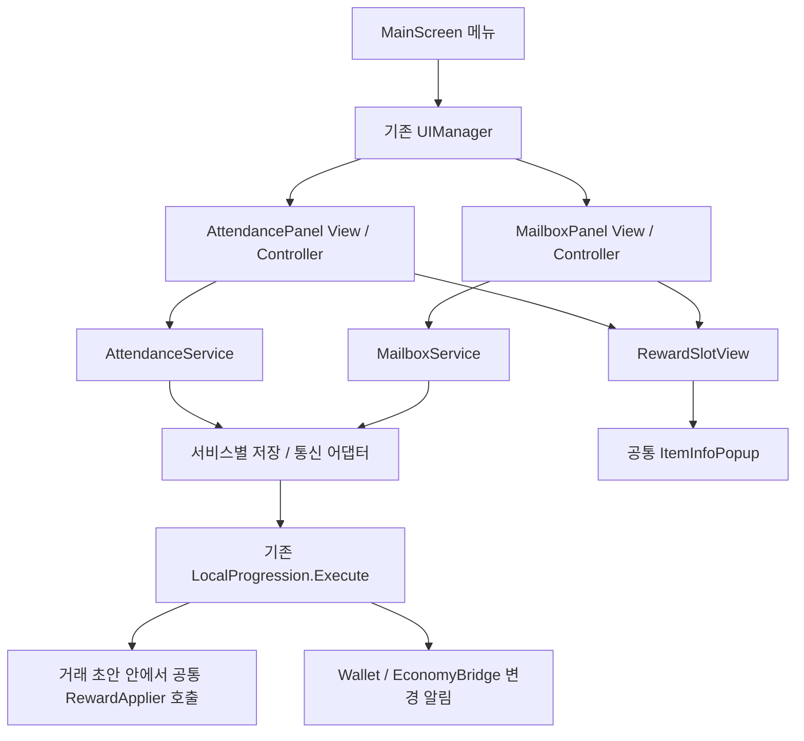

# UGUI 구조

공통 작업·아트·기기 검증 규칙은 [AGENTS.md](../../AGENTS.md)를 따른다.

## 코드와 에셋

| 위치 | 역할 |
|---|---|
| `Prefabs/Screens`, `Panels`, `Popups`, `Overlays`, `Huds`, `Items` | 인스펙터에서 편집하는 화면과 반복 위젯 |
| `Scripts/Core/UIManager.cs` | 화면·패널 스택, 뒤로가기, 토스트 |
| `UIViewCatalog.asset` | 프리팹·폰트·SFX·아이콘 참조 |
| `Scripts/Views/*Controller.cs` | 데이터 바인딩·사용자 동작 |
| `Scripts/Hud` | 파티·목표·전투 표시 |
| `Scripts/Bridges` | 씬 로딩·전투·UGUI 연결 |
| `Scripts/Core/UguiTheme.cs` | 공용 색·기준 치수 |
| `Editor` | 프리팹 생성·부분 마이그레이션·검증 |
| `Art/Font/Galmuri11 SDF.asset` | UI 기본 폰트 |

## 실행·수정

`bootstrap → UGUI_UIRoot(DontDestroyOnLoad) → SafeArea → 화면/패널/팝업/오버레이`.
`LoadManager → SceneRoutingBridge → UIManager.ReplaceScreen`, 탐색은 `PushPanel`을 사용한다.
화면 치수는 1080px 기준이며 실제 CanvasScaler·SafeArea는 루트 프리팹에서 확인한다.

프리팹을 직접 수정하거나 대상 프리팹만 마이그레이션한다. **Generate All은 수동 편집을 덮어쓰는 초기 뼈대 생성기**다.
새 위젯은 View 참조 → Items 프리팹 → UIViewCatalog 참조 → 컨트롤러 데이터 바인딩 순서로 추가한다.
목록 생성은 패널을 열 때 수행한다. 큰 목록은 가상화·풀링을 검토한다.

## 공통 연출과 기능 안내

`bootstrap/GameManager → Direction.GameDirectManager → FeatureGuidePlayer → UguiFeatureGuideSurface → FeatureGuideView`로 실행한다. Manager는 큐·저장·계정 수명을 소유하는 MonoBehaviour이고 Player와 화면 연결부는 일반 C# 클래스다. 실제 프리팹 참조·레이아웃·입력 필터는 MonoBehaviour View가 담당한다.

`Assets/_Project/Data/Direction/`의 `guide_development`, `guide_kingdom_army`, `guide_dungeon`, `guide_gacha`, `guide_mage_tower`는 독립 실습 SO다. 육성은 공격력 1회 강화, 왕국군은 대표 캐릭터의 종합·장비·전직 정보 열람, 던전은 입장 없는 정보 열람, 뽑기는 장비·마탑 스킬 각각 1회 실습이다. 기존 `first_start_menus`와 `first_reincarnation_guide`도 설명형으로 유지한다. 이전 설명형 완료를 새 실습 완료로 이관하지 않는다.

```csharp
// SO를 직접 전달하면 카탈로그 등록 없이도 요청할 수 있다.
bool accepted = Direction.GameDirectManager.Instance.RequestPlay(sequenceSO);
// ID 호출은 bootstrap의 sequences에 SO를 등록해야 한다.
Direction.GameDirectManager.Instance.RequestPlay("guide_development");
```

반환값은 접수 여부이며 완료 여부가 아니다. 동일 ID가 실행·대기 중이거나 이미 완료·건너뛰기 상태이면 거절하며 `LastError`로 이유를 제공한다. 다른 ID는 FIFO로 진행한다. `CancelCurrent()` 또는 실습의 ‘나중에 계속’은 완료·건너뛰기를 기록하지 않는다. 설명형만 `preview:true`로 저장 없이 반복할 수 있으며 실습형 preview는 거절한다.

### 데이터와 완료 조건

`Create → KingdomIdle → Direction → Sequence`로 SO를 만든다. 계정 저장에 사용하는 sequence ID와 각 단계 ID는 출시 후 다른 의미로 재사용하지 않는다. 단계에는 제목·본문·대상·배치, `context`(필요 화면), `completion`(Confirm/Click/Action), 클릭 이후 `destination`, `allowedTargets`, `allowScroll`을 설정한다. Action은 AttackOnce/EquipmentPullOnce/SkillPullOnce 중 하나다. `grantPracticeCoins`는 두 뽑기 Action에만 설정한다. 기존 SO의 추가 필드 기본값은 설명 확인/Main으로 호환된다. 본문의 `{dailyTickets}`는 실제 던전 카탈로그 값으로 치환한다.

- Confirm: 안내 카드 확인으로 완료한다. 지정한 스크롤만 허용할 수 있다.
- Click: 기존 실제 버튼을 누르고 목적 화면이 열린 것을 확인한다.
- Action: 기존 강화·뽑기 거래가 저장된 후 완료한다. 뽑기는 결과 창의 확인 버튼도 직접 누른다. 최대 강화 상태는 설명 확인으로 대체한다.

`FeatureGuideAnchor.Bind`로 컨트롤러가 동적 UI를 등록한다. Anchor는 자기 RectTransform만 해제해 늦은 Destroy가 새 등록을 지우지 않는다. 새로운 기능 대상은 대상 ID, 컨트롤러 등록, 화면 문맥 복원을 함께 추가한다. SO에 하이어라키 경로나 임의 메서드명을 저장하지 않는다.

### 저장과 입력 수명

장비 안내의 `ArmyEquipment`는 길이가 가변적인 콘텐츠가 아니라 실제 `ScrollRect.viewport`를 등록한다. View는 활성 조상 `RectMask2D`와 강조 영역을 교차해 화면 밖 콘텐츠가 전장까지 강조되지 않게 하며, 뷰포트 안내에서는 스크롤 위치를 자동으로 이동하거나 테두리를 확대하지 않는다.

`guide_mage_tower`는 **실제 마탑 탭 → 스킬 목록 → 장착 버튼 설명 → 해제 버튼 설명**의 네 단계다. `RequestPlay("guide_mage_tower")`로 요청하거나 `GameTest → Guide Test/실제 계정 저장/5 마탑 스킬`에서 실행한다. 장착·해제 실습은 요구하지 않으며 보유 스킬이 없어도 설명 확인으로 완료한다. `MageTower` 문맥은 기존 스킬 팝업을 정상 진행 화면으로 인정하고 미확인 단계 재개 시 복원한다. 마지막 확인 또는 건너뛰기 후에는 팝업을 닫는다. 진행 기록만 저장하며 스킬 소유·장착·재화는 변경하지 않는다. 에셋 누락 복구는 `KingdomIdle/Direction/Prepare mage tower guide`로 가능하다.

안내 진행은 `Modules["game-direct:" + sequenceId]`, 실습 성공은 `Modules["game-direct-action:" + sequenceId + ":" + stepId]`에 분리 저장한다. 강화·뽑기의 `Execute` 거래 초안에 성공 영수증을 함께 넣으므로 소비 직후 종료되어도 재소비하지 않는다. 안내 JSON 저장은 성공 영수증을 덮지 않는다. 주화 지급은 `Claims`의 안내 ID·Action별 키와 50개 지급을 같은 거래에 저장한다. 이미 지급한 주화는 중단 시 회수하지 않으며 추가 지급도 없다. 저장 실패는 초안을 확정하지 않고 안내 입력을 해제한다. 계정 전환은 이전 요청·대기열·지연 콜백을 무효화한다. 환생으로 초기화하지 않는다.

`FeatureGuideInputGate`는 실제 최상단 레이캐스트 대상이 허용 버튼인지 검사한다. 밝은 구멍 안이라고 모든 터치를 통과시키지 않는다. 설명 카드와 지정된 읽기 스크롤 외 조작은 막고, 버튼 복제·부모 이동·경제 처리 대체는 하지 않는다. 필요한 패널·결과 팝업은 안내 흐름에 포함하며 무관한 모달·로딩에서는 숨기고 입력 차단을 해제한다. 돌아오면 미확인 단계의 화면을 복원한다. 자동 전투 시간 배율은 변경하지 않는다. 뒤로가기는 건너뛰기이며 정상 완료 후 메인 화면으로 돌아간다.

### 직접 실행과 검증

bootstrap부터 Play하고 메인 화면에 진입한다. `GameTest` 컴포넌트의 `Guide Test/실제 계정 저장`에서 다섯 개를 각각 또는 순차 요청한다. 실제 계정 결과가 저장되므로 완료 후 다시 실행되지 않는 것이 정상이다. 환생 설명은 별도 미리보기 메뉴로 확인한다. 에셋 연결 복구는 편집 모드 `KingdomIdle/Direction/Prepare interactive guides`를 사용하며 기존 SO의 수동 편집은 덮어쓰지 않는다.

`KingdomIdle/Direction/Validate isolated guide acceptance`는 빈 PlayMode 씬·격리 계정·실제 프리팹·EventSystem 입력으로 검사하고 원래 편집 씬으로 돌아간다. 기존 안내 회귀, 다섯 안내 FIFO, 실제 강화·확률 뽑기, 중복 소비 방지, 지급·저장 실패와 재개를 검사한다. 장비 48개의 스크롤·강조 범위와 마탑 열기·재개도 검사하며 기록은 `AI/validation/game-direct-mage-20260921/`에 남긴다. 이전 네 실습 검증은 `AI/validation/game-direct-interactive-20260921/`에 보존한다. 화면 비율 캡처는 Editor 시뮬레이션이며 Android 실기기 결과가 아니다. 과거 0.15.0 검증 기록은 `AI/validation/game-direct-20260921/`에 보존한다.

자동 발생은 아직 연결하지 않는다. 다음 단계에서 신규 계정·스테이지 클리어 등의 외부 트리거가 해당 SO를 `RequestPlay`하도록 연결한다. 트리거는 게임 조건을 판단하고, 중복·완료 억제와 재개는 Manager에 맡긴다. 기존 계정에 안내 키가 없다는 이유만으로 신규 계정으로 판단하지 않는다.

`GameTest` 순차 실행은 현재 계정에서 미완료인 안내만 요청한다. 완료·건너뛰기 항목은 ID와 함께 `안내 생략` 일반 로그를 남기며 기록을 초기화하지 않는다. 패널 복원 직후 대상이 화면·마스크 밖에 있으면 `FeatureGuideView.TryRefreshLayout`은 false를 반환하고 호출자가 입력·참조를 정리한다. Player가 같은 미확인 단계를 다시 표시하므로 일시적인 레이아웃 미준비를 완료나 오류로 취급하지 않는다. 이 경계와 실제 `GameTest` 재개 경로의 회귀 결과는 `AI/validation/game-direct-visibility-20260921/`에 기록한다.

반복 실습은 PlayMode에서 `GameTest → Guide Test/실제 계정 저장/다섯 안내 테스트 기록 초기화 (재지급 허용)`를 실행한 뒤 개별 또는 순차 실행 메뉴를 사용한다. 초기화 메뉴는 실행 중인 안내와 대기열을 정리하고, 육성·왕국군·던전·뽑기·마탑의 **진행·실습 성공·체험 주화 지급 기록**을 한 번의 저장 거래로 지운다. 다음 실행에서는 강화·뽑기를 다시 수행하며 뽑기 주화 50개씩도 다시 지급한다. 현재 보유 재화·강화·장비·스킬은 유지되므로 반복 테스트 보상은 누적될 수 있다. 환생 안내와 다른 안내·퀘스트 기록은 유지한다. 이 초기화 경로는 `UNITY_EDITOR`에만 포함되며 계정 변경이나 저장 실패 시 초기화를 확정하지 않는다. 검증 기록은 `AI/validation/game-direct-reset-20260921/`에 남긴다.

## 전투 HUD

- `CompactHudBuilder.Apply`: `Screen_Main`, `Panel_Guide`, `Item_GuideStepRow`를 갱신한다.
- 메인 상단 두 줄: 재화 바 아래 `WaveHudView`의 스테이지 선택·처치 진행도, 그 아래 `GuideGoalView`의 가이드 한 줄. 클리어 스테이지에서는 선택 버튼과 `최고 스테이지 이동`만 표시한다. 기존 목표 이동·보상 수령 기능은 유지한다.
- `StageSelectPopupView/Controller`는 `Popup_StageSelect`를 카탈로그에서 열고 `StageManager.TryMoveToMainStage`로 이동한다. `CycleFrontierStage`는 이번 환생의 최고 도전 가능 위치이며 영구 클리어 기록과 분리한다. 구 저장은 현재 위치·이번 환생의 보스 클리어로 확인되는 위치만 복원한다.
- 던전은 메인 스테이지·가이드를 접고 상단에 목표·남은 시간을 표시한다. 하단 `메인 스테이지 복귀` → `Popup_DungeonReturnConfirm`의 확인에서만 기존 복귀 경로를 호출한다. 던전 결과 팝업과 자동 복귀는 기존 경로를 사용한다.
- 마탑 수동 스킬은 상단 스테이지 위치와 분리하여 우하단 왕국군 HUD 위에 유지한다. `StageBadgeAnchor`의 상단 모드는 위치를 움직이지 않고 기존 메뉴 숨김만 처리하며, 하단 던전 복귀 행은 왕국군 HUD 위에 정렬한다.
- 햄버거: 퀘스트/가이드, 가방, 설정, 반복 사냥 종료. 보스 자동 도전은 스테이지 인디케이터 옆에서 조작한다.
- `Panel_Guide`는 가이드·일일·주간·업적 네 탭을 제공한다. 상단 현재 퀘스트 카드는 가이드 탭에서만 표시하며 HUD와 같은 `QuestManager` 데이터를 쓴다.
- 하단 네 탭은 육성·왕국군·던전·뽑기. 시트가 열리면 HUD 목표 카드는 숨긴다.

`UguiPolishPass → UguiTypeNavPass`는 기존 스타일 보정 도구다. 스테이지 HUD의 부분 적용은 `StageHudPreparation.Apply`를 사용한다. `Screen_Main`과 두 신규 팝업, 카탈로그 참조만 저장하며 공용 스킨이나 다른 패널은 재생성하지 않는다.
일반 글자는 Galmuri11 기본 굵기·공유 머티리얼, 전투 숫자·컷인만 필요한 외곽선을 사용한다.
1080px 기준 패널 제목 40, 주요 버튼 30–34, 설명 26–28, 하단 라벨 30. 아이콘은 Layer Lab `PictoIcon/64` 명시 경로를 사용한다.

## 퀘스트 패널

`UIManager → GuidePanelController.Populate → BalanceQuestPanel.Bind`로 연결한다. `GuidePanelView`는 탭 부모·현재 가이드 카드·스크롤 목록의 직렬화 참조를 보관한다. 실제 패널 데이터는 `TutorialManager`가 아닌 `QuestManager.GetSnapshot(SelectedCategory)`에서 읽는다.

- 공용 `Items/Item_NavTabButton.prefab`을 패널마다 네 개 생성하고 `NavTabButtonView`로 선택 상태를 표시한다. 선택 탭이 바뀌면 기존 스크롤 목록 하나에 해당 범주만 바인딩한다.
- 최초 열기는 가이드 탭이다. 다른 패널에 덮였다 돌아오면 선택을 유지하고 최신 값을 다시 읽는다. 완전히 닫힌 패널은 파괴되므로 새로 열면 가이드부터 시작한다.
- 현재 계정 또는 선택 범주의 변경만 목록에 반영한다. 수령 완료 행은 가득 찬 게이지·낮춘 색상·비활성 `완료` 버튼으로 남긴다. 일일·주간 완료 행은 현재 기간에만 남으며, 이전 기간 미수령 보상은 수령 또는 만료 전까지 별도 기간 표시와 함께 보관한다.
- `GuideStepRowView.SetQuest`가 재화 아이콘(복수 보상 포함)·수량·종류와 내용·진행바를 표시한다. 우측 버튼은 진행 중 `이동`, 달성 시 `받기`, 수령 후 `완료`다. 수령은 표시 시 받은 `QuestClaimToken`을 쓰며 지급·저장 성공 후에만 완료 상태를 표시한다.
- `QuestNavigation`은 가이드 HUD와 카드의 화면 이동을 공유한다. 메뉴는 스택에 쌓아 복귀 상태를 보존하고 전투 목표는 패널을 닫는다. 마탑·환생은 기존 팝업을 사용하며 오프라인 수령/일괄 목표처럼 직접 이동할 화면이 없는 항목은 `진행 중`으로 표시한다.
- `CompactHudBuilder.ApplyQuestTabs`는 기존 `Panel_Guide`에 탭 컨테이너와 참조만 적용한다. 다른 HUD·공용 버튼 프리팹을 재생성하지 않는다. 구조와 학습용 설명은 `AI/quest-tabs-implementation-20260918.md`에 기록한다.

## 검증 진입점

- `KingdomIdle/UGUI/Validate/Check view wiring`: 직렬화 참조·missing script.
- `StageHudValidation.Run()`: 명시적으로 연 `balance-qa-stage-hud-*` 계정의 Editor Play에서 스테이지 선택·최고 이동·던전 복귀·환생 기록과 네 화면 크기를 검사한다. 일반 계정에서는 실행을 거절한다. 결과와 캡처는 `Recordings/StageHud20261018/`, 이번 적용 검증 기록은 `AI/validation/stage-hud-20261018/report.json`에 보관한다.
- `KingdomIdle/UGUI/Run client regression checks`: 기존 클라이언트 회귀 검사.
- `KingdomIdle/UGUI/Apply compact battle HUD`: 이번 HUD 프리팹 적용.
- `KingdomIdle/UGUI/Apply quest category tabs` / `CompactHudBuilder.ApplyQuestTabs`: 퀘스트 패널의 탭 컨테이너·직렬화 참조만 적용.
- `KingdomIdle/UGUI/Apply quest reward cards` / `QuestCardPrefabBuilder.Apply`: 기존 행 프리팹의 GUID와 참조를 보존하며 보상·진행바·행동 버튼을 연결한다. 기존 전체 생성기도 같은 업그레이드를 사용한다.
- `KingdomIdle.UGUI.Editor.QuestTabAcceptance.Run()`: 빈 검사 씬의 PlayMode에서 실제 프리팹 복제본·격리 계정으로 탭 선택, 수령 완료 유지, 재활성화, 중복 수령 방지, 기간 초기화를 검사한다. 운영 계정이 열린 씬에서는 실행을 거절한다.
- `TitleLobbyDeviceBuild.Build`: `.lobbyqa` ARM64 Development 진단 APK. `BuildForManualTesting`은 같은 패키지를 사용하면서 자동 진단·테스트 계정 주입을 제외한다. `LOBBY_QA_OUTPUT`으로 출력 위치, `DEVICE_BUILD_PURPOSE`로 용도를 지정한다. 앱·APK 이름에는 용도와 버전·빌드 번호를 넣으며 빌드마다 versionCode가 증가한다. 성공한 APK 경로와 메타데이터는 출력 폴더의 `build.json`에서 읽는다. 기기 정리·최종 설치 기준은 [프로젝트 지침](../../AGENTS.md)을 따른다.
- `BalanceEditorValidation.BuildAndroidForManualTesting`: 밸런스·저장 데이터 이관·직렬화 참조 검사를 실행하고 글리프를 준비한 뒤 직접 플레이용 APK를 만든다.
- `CompactHudBuilder.ApplyAndBuild`: HUD 적용 후 위 Android 빌드.
- `BattleHudDeviceProbe`: QA 빌드 전용 HUD 상태·레이아웃·진행 fixture. 일반 배포에는 포함되지 않는다.

Android 검사 도우미·결과는 `AI/qa/hud/`, `Recordings/HudRevision/`에 있다. `Recordings`는 Git 제외다.
퀘스트 탭 결과는 `AI/validation/quest-tabs-20260918/`에 있다. 그 안의 PNG는 실제 프리팹을 PreviewScene에서 고정 예시 데이터로 렌더한 비교 자료이며, 게임플레이 또는 Android 기기 캡처와 구별한다.

## 마탑·뽑기

`MageUiPreparation`은 10종 스킬 셀, 개화 선택이 있는 상세 창, 목재·청동 뽑기 버튼과 결과 창을 준비한다. 스킬 등급은 없으며 청동 테두리와 문구로 장착, 보라색과 아이콘 변형으로 개화를 표시한다. 스킬 셀은 재사용한다. `MageSkillPresentation`은 등록 SO와 저장 상태를 읽는다. `GachaButtonFlare`는 unscaled-time 가장자리 청색 연출을 재사용하며, 저사양에서도 결제 시점·취소 동작은 동일하다. 창을 닫으면 결제 전 연출을 취소하고 연속 터치에는 한 번만 결제한다.

마탑 Android 검증 도우미는 `AI/qa/mage/`, 상세 근거는 [통합 보고서](../../Docs/ArtPreparation/MAGE_INTEGRATION_VALIDATION.md)에 있다.

`MageManualCastHud`는 자동 시전을 끄면 장착 슬롯을 우측 스테이지 표시 위로 순서대로 펼치고 다시 켜면 대응하는 퇴장 애니메이션으로 접는다. 준비 상태는 점등하고 쿨다운은 시계 방향 음영과 남은 초로 표시한다. 탭은 자동 조준 시전, 드래그는 전투 지점 지정이다. `MagicAimGraphic`은 실제 원형 판정 반경을 쿼터뷰 타원으로 투영하고 전장 도트 크기에 맞춰 표시한다. 빈 슬롯은 숨기며 UI 위 드롭, 화면 밖, 전투 전환, 포커스 상실은 시전 없이 취소한다. 얼음 송곳과 유성우는 탭으로만 시전한다.

장비와 가방은 `VirtualEquipmentGrid`로 화면에 보이는 카드만 만든다. 보관함 초과 보상은 기존 수량형 저장 구조에 영구 보관하여 전투·던전·뽑기를 막지 않는다. `EquipmentData.DisplayName`은 화면용 이름이며 기존 저장 키와 아이템 코드는 유지한다. 상세 스탯은 실제 `PlayerStatus` 계산을 사용하고 변경된 계산식만 다시 그린다.

현재 검증 진입점은 `PlayabilityRevisionPreparation.Validate`, Unity 실행 검사 `KingdomIdle.UGUI.Editor.PlayabilityLiveValidation.Run`, Android `AI/qa/mage/playability_checks.py`다. 증거는 `Recordings/PlayabilityRevision`과 [플레이 개선 검증 기록](../../Docs/ArtPreparation/PLAYABILITY_20260918.md)에 있다.

0.11.1 후속 검증은 `PlayabilityRevisionPreparation.ValidateSessionRoutes`와 `AI/qa/mage/player_*.py`를 사용한다. 가이드 이동은 대상 탭을 한 번 지정하고, 스테이지 배지는 반복 사냥에서 다음 구간 도전을 제공한다. 프로필은 실제 진행 수치를 읽으며 던전 팝업은 짧은 웨이브 전환 동안 입장 요청을 유지하고 닫기 시 취소한다. [30분 × 3회 실플레이 기록](../../Docs/ArtPreparation/PLAYER_SIMULATION_20260918.md)에 수정과 성능 측정이 있다.

퀘스트 병합(2026-09-21): UI는 `QuestManager`의 snapshot/event를 읽고 수령은 `TryClaim`으로 요청한다. `LocalProgression`의 0.75초 스킬 자동 저장 성공 뒤 기존 변경 알림으로 갱신하며 별도 표시 타이머는 두지 않는다. 이동은 목표 ID까지 전달해 소환·장비·전직 탭을 선택한다. 프리팹 배치는 퀘스트 카드 작업본을 유지하고 외부 에셋 참조는 프로젝트 내 작업본으로 연결한다.

## 출석·우편함 구현 설계

2026-10-25 논의 기준의 **구현 전 설계**다. 아래 신규 클래스·프리팹·API는 제안 이름이며 아직 프로젝트에 구현되지 않았다. 이 절은 이전의 우편별 부분 성공 제안을 대체한다. 광고 SDK·광고 보상 정책은 이번 구현 범위에 포함하지 않는다.

### 확정 요구와 구현 경계

| 항목 | 동작 |
|---|---|
| 출석 주기 | 달력 월과 무관한 누적 28일. 결석하거나 달이 바뀌어도 진행도 유지 |
| 출석 진도 | **보상 수령·저장 성공 시에만** 1일 증가. 접속만 하거나 받지 않으면 같은 일차 유지 |
| 하루 경계 | 한국시간 00:00에 다음 일일 수령 기회가 열림. 한 날짜에 최대 한 번 |
| 주기 완료 | 28일차를 받으면 당일은 완료 상태. 다음 날짜부터 새 주기의 1일차 수령 가능. 주기 변경으로 마지막 수령 날짜를 지우지 않음 |
| 출석 화면 | 7열 × 4행, 총 28일과 하단 받기 버튼을 스크롤 없이 한 페이지에 표시 |
| 우편 만료 | 생성 시 정한 만료 UTC 사용. 우편함 진입 때 만료 우편 제거, 열린 중에도 만료 시 즉시 목록에서 제거 |
| 우편 수령 | 개별 우편의 모든 보상을 함께 지급하고 성공한 우편을 즉시 목록에서 제거 |
| 모두 받기 | 요청 대상으로 고정한 **모든 우편의 모든 보상**을 전부 지급·저장할 수 있을 때만 성공. 일부 지급·일부 수령 처리 없음 |
| 아이템 표시 | 공통 이미지 슬롯 + 수량. 슬롯 클릭은 공통 아이템 설명 팝업만 열고 보상을 지급하지 않음 |
| 우편 삭제와 기록 | 활성 우편 목록에서는 제거하지만 중복 방지·복구용 수령 기록은 별도 보존 |

28일차 다음 날짜에 새 보상판을 보여주더라도 저장된 주기 변경은 새 1일차 수령 거래에서 확정한다. 화면을 그리는 동작만으로 출석 진도나 재화를 변경하지 않는다. 출석 보상 종류·수량은 시안 값으로 출시 확정하지 않으며 운영 보상표가 별도로 필요하다.

모두 받기의 대상은 클릭 시의 유효한 미수령 우편 ID 집합으로 고정한다. 우편 목록이 여러 페이지여도 현재 화면에 렌더된 행만 받는 의미가 되어서는 안 된다. 서버가 전체 대상 ID를 제공하거나 같은 대상을 식별하는 수령 토큰을 제공해야 한다. 요청 이후 도착한 새 우편은 다음 수령 대상이다.

수령 검증은 거래 안에서 한 번 읽은 기준 시각을 사용하며 `ExpiresUtc <= nowUtc`이면 만료다. 거래의 유효성 검사에서 대상 하나라도 만료·기수령·삭제·보상 변경 상태이면 **이번 지급은 전부 거절**하고 최신 목록을 표시한다. 사용자가 갱신된 대상을 다시 확인해 받도록 하며 다른 대상 집합으로 자동 수령하지 않는다. 이미 성공한 동일 요청의 재시도는 이 검사보다 먼저 기존 영수증을 반환한다.

**만료 정리는 지급 거래와 별개**다. 수령이 실패해도 만료된 우편은 다시 나타나지 않는다. 영구 삭제가 저장 실패로 지연되어도 목록·배지·수령 대상에서는 만료 시각으로 제외하고 이후 정리를 재시도한다. 미만료 우편은 수령 실패 시 그대로 보존한다.

### 역할 분리와 의존 방향



도식의 저장/통신 어댑터는 같은 계층을 묶어 표현한 것이며 출석·우편의 운영 정책을 합친 서비스가 아니다. `AttendanceService`와 `MailboxService`는 독립된 일반 C# 클래스이고, 공통 지급기와 표시 컴포넌트만 공유한다. 각 서비스는 수령 자격을 판단하고, `RewardApplier`는 이미 승인된 보상을 전달받은 거래 초안에 적용한다. 공통 지급기는 출석 일차나 우편 만료 정책을 알지 않는다.

기존 `GameManager.Init()`의 `ReincarnationService` 구성 방식에 맞춰 두 서비스를 각각 생성·소유하는 방향이다. 계정 준비·변경·복귀 연결은 `GameManager`의 얇은 수명 연결부에서 전달하고 서비스에 UI 참조를 넣지 않는다. `LocalProgression.AccountChanged`와 `AccountGeneration`으로 이전 계정 캐시·요청 콜백을 무효화한다. 계정 준비 전에는 조회/수령을 거절하고 임의의 guest 상태를 열지 않는다.

### 신규 코드와 데이터

도메인 코드는 `Assets/_Project/Scripts/Attendance/`, `Mailbox/`, `Rewards/`에 나누고 UI는 기존 `Assets/UGUI/Scripts/Views/` 및 `Views/Items/`를 사용한다. 실제 생성 시 기존 namespace·asmdef 경계를 따른다.

| 제안 구성 | 핵심 데이터·메서드 | 책임 |
|---|---|---|
| `AttendanceState` | `CycleNumber`, `ClaimedDays`(0–28), `LastClaimDayKst` | 계정별 수령 진도. 환생으로 초기화하지 않음 |
| `AttendanceRewardTableSO` | 버전, 1–28일 보상 정의 | 로컬 표시·검증용 보상표. 실제 서버 지급 정의와 버전 대응 |
| `AttendanceClaimToken` | 계정 세대, 주기, 일차, 날짜 키, 보상표 버전 | 오래된 화면이 새 날짜·다른 주기의 보상을 대신 받는 것 방지 |
| `AttendanceSnapshot` | 28개 일차 상태, 받을 일차, 진행도, 다음 자정, 토큰 | 읽기 전용 UI 데이터 |
| `AttendanceService` | `GetSnapshot`, `RefreshAsync`, `TryClaimAsync`, `Changed` | 출석 조회·기간 판단·수령 조정 |
| `MailMessage` | 고유 `MailId`, 제목, 발신자, 본문, 생성·만료 UTC, 보상 명세, 버전 | 발급된 우편 한 통. 금액은 클라이언트 입력에서 받지 않음 |
| `MailboxSnapshot` | 유효 우편, 전체 수령 대상 토큰, 조회 상태 | 만료 우편을 제외한 읽기 전용 목록 |
| `MailClaimToken` | 계정 세대, 대상 우편 ID와 각 버전 | 개별·일괄 수령 대상 고정 |
| `MailboxService` | `GetSnapshot`, `RefreshAsync`, `TryClaimAsync`, `TryClaimAllAsync`, `Changed` | 만료 정리·조회·전체 성공 수령 조정 |
| `RewardGrant` / `RewardItemRef` | 종류, 기존 식별자, 양수 `long` 수량 | UI/저장 공통 보상 명세. Sprite·GameObject를 저장하거나 전송하지 않음 |
| `RewardApplier` | `TryApply(ProgressionState draft, grants)` | 한 거래 초안에 모든 지급 반영. 하나라도 불가하면 false. 자체 저장/이벤트/통신 없음 |
| `ClaimReceipt` | 고유 `RequestId`, 출처, 대상 키, 확정 보상, 확정 UTC | 재시도 중복 방지·확정 결과 복원 |
| `ClaimResult` | 상태, 이유, 영수증, 최신 snapshot | 성공/미지급 확정/결과 확인 중/로컬 반영 대기 구분 |
| `RewardPresentationResolver` | `Resolve(RewardItemRef)` | 기존 카탈로그 아이콘·아이템 이름과 짧은 설명을 화면 데이터로 변환 |

`RefreshAsync`와 수령 메서드는 프로젝트의 UniTask 또는 기존 콜백을 내부 어댑터로 감싸는 형태를 따른다. `GetSnapshot`은 네트워크·파일 저장 없이 마지막 확정 데이터의 읽기 전용 복사본을 반환한다. 두 서비스에 각각 `IAttendanceBackend`, `IMailboxBackend` 경계를 두고 로컬 검증 구현과 서버 구현을 교체한다. 하나의 요청에서 로컬 자체 지급과 서버 지급을 동시에 실행하거나, 서버 실패 시 로컬 지급으로 대체하지 않는다.

첫 구현은 시안에 필요한 기존 재화 보상부터 연결한다. 재화 ID는 기존 `eCurrency`를 사용한다. 장비 보상을 지원할 때는 기존 장비 코드/인스턴스 규칙을 연결하고 `EquipmentManager.Grant(..., allowPending:true)` 경로를 사용한다. 지원하지 않는 보상은 무시하고 성공시키지 않고 전체 거래를 거절한다. 제거된 스킬·비활성 장비를 범용 보상이라는 이유로 복원하지 않는다.

`ProgressionState`에는 출석 상태, 로컬 모드의 활성 우편 저장, 확정 수령 기록과 서버 모드의 미완료 요청 기록을 명시적인 필드/타입으로 추가한다. `Claims`의 중복 방지 키는 출처별 접두사로 구분하고, 영수증은 대상·지급량을 복원할 수 있게 별도로 저장한다. 임의 JSON을 `Modules`에 넣어 서로 다른 수명을 섞지 않는다. 새 mutable 상태는 `DeepClone()`의 깊은 복사, `Open()`의 기존 저장 기본값/이관, `Validate()`의 범위·중복·양수 수량 검사에 모두 포함한다. 최상위 Schema를 바꿀 경우 기존 계정 이관 없이 거절되도록 두지 않는다.

전투 중 계속 증가하는 `ProgressionState.Revision`을 수령 거절 조건으로 사용하지 않는다. 출석은 주기·일차·날짜·보상 버전, 우편은 대상 ID·개별 버전처럼 **해당 수령 자격에 필요한 값**만 비교한다. 장비·재화 합산은 checked 계산으로 초과를 검사하고 초안의 일부 변경을 원본에 노출하지 않는다.

### 출석 수령 순서

1. 로그인 후 계정 준비, 출석 패널 진입, 앱 복귀·자정 경계에서 상태를 새로 확인한다. 접속 또는 조회 자체로 일차를 증가시키지 않는다.
2. 예를 들어 `ClaimedDays=7`이면 며칠을 쉬어도 다음 받을 보상은 8일차다. 처음 받거나 `todayKst > LastClaimDayKst`일 때만 일일 기회를 연다. 같은 날짜와 이전 날짜에서는 받을 수 없으므로 시각 역행만으로 기회를 다시 열지 않는다.
3. 받기를 누르면 표시된 토큰과 새 요청 ID를 전달하고 해당 수령 버튼을 처리 중 상태로 바꾼다.
4. 거래에서 계정 세대, 토큰의 날짜/주기/일차, 당일 미수령, 보상표 버전을 다시 검사한다. 자정 전에 열린 화면의 토큰으로 자정 이후 새 보상을 자동 선택하지 않는다.
5. 이전 주기 28일을 완료했고 날짜가 바뀌었다면 새 주기를 준비한다. 같은 초안에 보상 지급, 완료 일수 +1, 마지막 수령 날짜, 중복 방지 키·영수증을 반영한다.
6. 저장이 성공한 뒤에만 완료 표시와 수령 결과를 보여준다. 실패하면 진행도·재화·날짜가 모두 이전 상태다.

28일차 완료 당일은 28개 완료 상태로 유지한다. 다음 날짜의 snapshot은 새 주기의 1일차 수령 가능 상태를 계산해 보여줄 수 있지만, 실제 새 주기 저장은 수령 거래 안에서 확정한다. 자정은 일일 기회 갱신이며, 누적 일수의 일괄 초기화가 아니다. 서버 모드에서 수령 날짜의 권위는 서버 시간에 두고 기기 시계는 표시 보조로만 사용한다. 날짜 계산은 기존 `QuestPeriod.At(utc)`의 KST 계산을 참고하되 퀘스트 진행 상태에 출석을 저장하지 않는다.

### 우편 개별·모두 받기 순서

개별 받기는 대상 ID가 하나인 동일한 배치 수령 경로로 처리한다. 개별/모두 받기에 별도의 지급 코드를 만들지 않는다.

1. 진입 시 최신 우편을 조회하고 만료 우편을 정리한다. 로딩/오류를 빈 우편함으로 표시하지 않는다.
2. 모두 받기를 누르면 snapshot의 전체 유효 대상 ID 집합을 고정한다. 대상이 없으면 버튼은 비활성이다. 중복 ID·서로 다른 계정 대상은 거절한다.
3. 계정 단위로 진행 중인 수령을 확인하고, 같은 우편의 개별 받기와 모두 받기를 동시에 실행하지 않는다. 로컬 상태 저장은 기존 직렬 거래 구조를 따른다.
4. 한 번의 거래에서 대상 전체의 미수령·유효기간·버전·보상 정의·수량을 검증한다. 이후 모든 보상을 같은 초안에 반영한다.
5. 그 초안에서 모든 대상 우편 제거, 출처별 중복 방지 기록, 전체 영수증을 함께 저장한다. 하나라도 검증·지급·저장에 실패하면 초안 전체를 버린다.
6. 저장 성공 후 목록·배지·재화가 한 번에 갱신되고 확정 보상 합계를 하나의 결과 팝업으로 보여준다. 같은 재화는 표시에서 합칠 수 있으나 장비/서로 다른 아이템을 임의 합산하지 않는다.

로컬 구현의 개념 코드는 다음과 같다. `RequireValidBatch` 등은 설명용 이름이며 신규 공개 API를 모두 만들라는 의미가 아니다.

```text
knownReceipt = FindReceipt(requestId, exactPayload)
if knownReceipt exists: return previous committed result

committed = LocalProgression.Execute("mail-claim", draft => {
    RequireSameAccountAndNoDuplicateSources(draft, token)
    grants = RequireValidBatch(draft, token, oneTrustedNow)
    if !RewardApplier.TryApply(draft, grants): return false
    RemoveEveryTargetMail(draft, token)
    RecordAllSourceClaimsAndReceipt(draft, requestId, token, grants)
    return true
})

if committed: publish confirmed success
else: publish zero-new-grants failure and refresh valid mailbox
```

`Execute`는 우편마다 호출하지 않고 전체 배치에 한 번 호출한다. 거래 내부에서는 `LocalProgression.Credit(draft, ...)`와 상태를 받는 `EquipmentManager.Grant`를 쓴다. `EconomyBridge.Add()`나 `EquipmentManager.GetEquipment()`는 내부에서 다시 `Execute`를 열기 때문에 호출하지 않는다. 저장 전 성공 예정으로 채운 결과는 `Execute == false`일 때 성공으로 반환하지 않는다. 실제 코드에서는 검증 실패·overflow·저장 실패를 구분한다.

대상 하나가 만료되어 배치가 거절되면 유효한 나머지 우편은 미수령으로 남고 만료 우편만 정리된다. 안내는 `우편함이 갱신되었습니다. 다시 받아 주세요.`로 표시한다. 일반 미지급 실패는 `보상을 받지 못했습니다. 다시 시도해 주세요.`와 실제 원인을 제공한다. 부분 성공 건수나 부분 획득 보상 팝업은 사용하지 않는다.

### 서버 연결과 결과 불명 복구

**현재 코드의 제약:** `LocalProgression.IsLocalAuthority`는 true이고 `Wallet.SetOwner()`는 서버 잔액을 적용하지 않는다. 따라서 로컬 거래 하나로 검증할 수 있는 범위와 실제 서버 수령 범위를 구분한다. `NetworkManager` 래퍼를 추가하는 것만으로 서버 데이터베이스의 원자성이 생기지는 않는다.

먼저 로컬 저장 어댑터와 격리 테스트 데이터로 화면·전체 성공 거래를 검증한다. 출시 서버 연결은 기존 PlayFab `ExecuteFunction` 경로에 다음 계약을 추가하는 방향이다. 명칭은 제안이며 배포된 함수가 확인된 것은 아니다.

| 제안 요청 | 요청 내용 | 응답 요구 |
|---|---|---|
| `GetAttendance` | 인증 컨텍스트 | 서버 시각, 현재 주기/완료 일수/일일 상태, 보상 정의·버전, 수령 토큰 |
| `ClaimAttendance` | 요청 ID, 표시했던 토큰 | 확정 영수증 또는 미지급 오류, 최신 출석 상태 |
| `GetMailbox` | 인증 컨텍스트, 필요 시 페이지 커서 | 만료 제외 우편, 서버 시각, 전체 수령 대상 토큰 |
| `ClaimMailBatch` | 요청 ID, 고정 대상 ID/버전 또는 동등한 토큰 | **전체** 확정 영수증 또는 **전체** 미지급 오류, 최신 목록 |
| `GetClaimResult` / 미반영 영수증 동기화 | 이전 요청 ID 또는 계정별 복구 커서 | 성공/미지급 확정/처리 중을 구분하고 원래 영수증 복원 |

서버는 인증된 계정을 기준으로 대상·금액을 읽고 클라이언트가 제시한 금액을 신뢰하지 않는다. 우편의 수령 표시·지급 권리·영수증 발급은 서버 저장소의 **동일 거래**로 확정해야 한다. 기존 서버가 이 계약을 지원하지 않으면 단건 지급 API를 순서대로 호출해 모두 받기를 구현하지 않는다. 실제 저장소의 거래 범위와 API 최대 대상 수는 백엔드 확인 사항이다. 요청 크기 제한이 있다면 실패 시에도 전부 취소되는 서버 작업으로 처리하거나 명시적으로 거절하며, 여러 독립 배치로 쪼개 부분 성공을 만들지 않는다.

현재 로컬 경제를 유지하는 연결안은 서버가 발급한 전체 영수증을 클라이언트가 `LocalProgression.Execute()` 한 번으로 반영하는 방식이다. 이는 **서버 확정과 로컬 반영이 각각 원자적**이라는 뜻이며 두 저장소가 동시에 한 번에 확정된다는 뜻은 아니다. 서버 확정 후 로컬 저장 실패는 일반 수령 실패로 되돌리지 않고 `동기화 대기`로 보존해 동일 영수증 전체를 재반영한다. 이 상태에서 새 요청 ID로 재지급하거나 서버 우편을 되살리지 않는다. 다른 기기 간 경제 상태 통합·로컬 저장 소실 복구는 기존 계정 저장 권한 정책과 함께 별도 검증해야 한다.

네트워크 전송 전 요청 ID·고정 대상·요청 본문 식별값을 계정별 pending 기록에 저장한다. 그 기록 저장에 실패하면 전송하지 않는다. 같은 요청 ID의 재시도는 같은 내용을 보내며, 다른 내용은 충돌이다. 앱 종료 후에도 원래 요청을 조회할 수 있어야 한다. 서버는 기존 영수증을 먼저 확인하여 이미 성공한 요청을 이후 만료 상태 때문에 실패로 뒤집지 않는다. 미지급 실패가 확정된 뒤 사용자가 다시 받기를 누르면 최신 토큰과 새 요청 ID를 쓴다.

pending/영수증은 안정적인 계정 키에 귀속시키고 `AccountGeneration`을 영구 계정 ID로 사용하지 않는다. 토큰의 계정 세대는 클라이언트 내부 검증용이며 서버의 재시도 요청 본문에 넣지 않는다. 재로그인·앱 재시작 후 같은 계정의 원래 요청을 복구할 때는 현재 계정 세대를 새로 캡처해 콜백 수명을 검사한다. 이전 실행의 계정 세대가 다르다는 이유로 정상 영수증 복구를 막지 않는다.

확정 영수증의 로컬 재반영은 **새 수령 심사와 별도 경로**다. 그동안 날짜가 바뀌거나 우편이 만료되었더라도 자격을 다시 판정하지 않고 원래 확정 날짜·보상·진행 결과를 반영한다. 이미 반영한 영수증은 건너뛰며 새로운 진도를 과거 snapshot으로 덮지 않는다. 미완료 수령을 먼저 복구한 뒤 새 수령을 허용하고, 서버 확정 순서·서비스별 버전으로 복구 순서를 검증한다. 서버의 예전 전체 재화 잔액으로 로컬 전투 보상까지 덮어쓰지 않는다.

| 상태 | 화면과 다음 동작 |
|---|---|
| `Succeeded` | 지급 반영까지 확인. 대상 제거, 결과 표시, 받기 해제 |
| `Rejected` | 이번 요청에서 신규 지급 0 확정. 유효 우편 유지, 원인 안내, 목록 갱신 후 재시도 |
| `PendingConfirmation` | 응답 유실/서버 처리 중. `수령 결과 확인 중` 표시, 같은 요청 상태 조회. 미지급으로 단정하지 않음 |
| `PendingLocalApply` | 서버는 확정, 로컬 저장 미완료. `보상 반영 중` 표시, 같은 영수증 재반영. 새 지급 요청 차단 |

`Rejected`의 이유는 계정 변경·오늘 수령 완료·오래된 토큰·우편함 변경·잘못된 보상·저장 실패 등으로 구분한다. 통신 오류만으로 `Rejected`라고 판단하지 않는다. 확정된 실패/성공이 될 때까지 pending을 추적하되 화면을 계속 잠그지는 않고 조회·복구 안내를 제공한다.

### 화면·프리팹 구성

| 신규 프리팹 / View | 구성과 동작 |
|---|---|
| `Panel_Attendance` / `AttendancePanelView` | `BottomSheetView` 상속. 제목, 누적 진행도, 7열 × 4행, 일일 갱신 안내, 받기 버튼. ScrollRect 없음 |
| `Item_AttendanceDay` / `AttendanceDayView` | 일차 라벨, 공통 보상 슬롯, 오늘/수령 완료/잠김 표시. 잠긴 날짜도 아이템 설명 열람 가능 |
| `Panel_Mailbox` / `MailboxPanelView` | `BottomSheetView` 상속. 로딩/오류/빈 상태, 세로 목록, 하단 모두 받기. 출석의 무스크롤 조건은 우편 목록에 적용하지 않음 |
| `Item_MailRow` / `MailRowView` | 제목·발신자·남은 시간, 여러 보상 슬롯, 개별 받기. 제목/본문 영역만 상세 열기 |
| `Popup_MailDetail` / `MailDetailPopupView` | 제목·본문·만료 시간·보상 슬롯·받기. 대상 수령/만료 시 관련 상세와 하위 설명 팝업 정리 |
| `Item_RewardSlot` / `RewardSlotView` | 아이콘, 수량, 공통 프레임, 클릭 이벤트. 지급 코드와 출석/우편 참조 없음 |
| `Popup_ItemInfo` / `ItemInfoPopupView` | 참조 2번 방식의 아이콘·이름·짧은 설명·닫기. 출석·우편·수령 결과에서 같은 진입점 사용 |
| `Popup_RewardReceipt` / `RewardReceiptPopupView` | 저장까지 확정된 전체 영수증의 보상 목록. 아이템 클릭은 같은 설명 팝업 사용 |

수량은 기존 `NumberNotation`과 표시 설정을 따른다. 재화는 장비 희귀도 색을 쓰지 않는다. 아이템 설명 팝업은 보상 식별자로 내용을 찾으며 출석 일차·우편 ID를 알아야 열리는 구조로 만들지 않는다. 기존 가챠 결과 팝업은 재뽑기/가챠 테이블 의존성이 있어 일반 수령 팝업으로 그대로 사용하지 않는다.

28칸은 `GridLayoutGroup`의 FixedColumnCount=7로 구성하고 SafeArea 안의 가용 폭·높이에 맞춰 셀 크기와 간격을 계산한다. 좁은 기기에서도 제목·수량·하단 버튼과 터치 영역이 유지되어야 한다. 한 칸에 복수 보상을 넣는 출석 보상표가 필요하면 7열 가독성 검증과 배치를 먼저 확정하며, 시안 단계에서 임의로 보상을 생략하지 않는다. 우편은 기존 수직 ScrollRect/Viewport/Content 패턴을 사용하고 ID별 행 재사용을 우선한다.

패널마다 Controller 인스턴스를 만들고 `BottomSheetView.OnClosed`에서 Dispose한다. Controller는 snapshot을 표시하고 클릭을 서비스로 전달할 뿐 재화를 직접 쓰지 않는다. UI 전용 `openGeneration`/disposed 검사와 계정 `AccountGeneration` 검사를 분리하여 오래된 응답이 새 화면을 덮지 않게 한다. 화면이 닫혀도 이미 전송된 수령 거래가 취소된 것은 아니며 서비스가 결과·영수증 처리를 계속한다. 결과 팝업은 View가 `activeInHierarchy`이고 현재 보이는 소유 패널일 때만 연다. UIManager가 스택 뒤의 패널을 비활성화만 할 수도 있으므로 disposed 검사만으로 판정하지 않는다. 닫히거나 가려진 화면에 결과 팝업을 뒤늦게 열지 않고 복귀/재진입 때 최신 상태를 보여준다.

### 기존 코드 변경 위치

| 기존 위치 | 연결할 내용 |
|---|---|
| `MainScreenView`, `MainScreenController.BindMenus()` | `btnMenuAttendance` 추가, 숨겨진 `btnMenuMail` 활성화. 드롭다운 닫고 `PushPanel(..., isTabPanel:false)` |
| `UIIds` | 기존 `Mailbox=21` 유지. 출석은 기존 번호를 바꾸지 않고 사용하지 않는 ID 추가 |
| `UIManager.CreatePanel/PopulatePanel/GetPanelDisplayName` | 두 패널 생성·바인딩·제목 등록. Guide/Inventory처럼 LayerOverlays에 생성 |
| `UIViewCatalog` | 신규 패널·팝업·반복 아이템 프리팹 참조. 기존 재화 아이콘 재사용 |
| `BottomSheetView.OnClosed`, `UIManager.ReplaceScreen/OnDestroy` | Controller 구독 해제, 소유 팝업 정리, 늦은 UI 콜백 무효화 |
| `ModalBackHandler.Bind` | 우편 상세·아이템 설명·수령 결과 모달 등록. 패널 자체는 기존 UIManager 스택으로 처리 |
| `MainScreenController.GetCurrencyIcon/GetCurrencyLabelKor` | 공통 표시 resolver로 매핑 공유. 필요하면 기존 호출용 wrapper 유지 |
| `ScreenGens`, `UguiPolishPass`, `CompactHudBuilder` | 출석 메뉴 생성·라벨·배치, 우편 강제 숨김 제거, 새 메뉴 높이와 안전영역 검증 |
| `GameManager.Init` 및 계정/앱 복귀 연결 | 독립 서비스 생성·수명 소유, 조회/복구 진입점. 기존 오프라인 보상 지급 경로와 별개 |
| `ProgressionState`, `LocalProgression.Open/Validate` | 상태·깊은 복사·저장 이관·검증. 전체 배치는 기존 Execute 한 번 |
| `NetworkManager`, `Server/DTO` | 실제 합의된 조회·수령·결과 복구 API 연결. 현재 서버 잔액 설정 메서드의 단순 재호출로 대체하지 않음 |

메뉴 패널과 하위 모달은 `LayerOverlays`에 놓고 새 모달을 마지막 sibling으로 올린다. 더 앞에 그려지는 `LayerPopups`에 아이템 설명만 놓아 패널 뒤로 숨지 않게 한다. X/배경/Android 뒤로가기는 같은 닫기 경로를 쓰고 `아이템 설명 → 우편 상세 → 우편함 → 메인` 순서를 유지한다. 각 팝업은 owner를 기억하여 부모가 수령·만료·화면 전환으로 닫힐 때 함께 정리한다.

상단 재화는 기존 `LocalProgression.Changed → Wallet → EconomyBridge.OnAmountChanged → MainScreenController` 경로로 갱신한다. 출석/우편 Controller에서 상단 텍스트를 직접 덮어쓰지 않는다. 서비스 이벤트는 snapshot 내용이 달라졌을 때만 보낸다. 만료/자정 감지는 서버 기준 시각에 맞춘 다음 경계에서 수행하고, 남은 시간 문자열은 표시 단위가 바뀔 때만 갱신한다. 매 프레임 전체 목록 조회·저장·레이아웃 재생성은 하지 않는다.

### 구현 순서와 완료 조건

1. **도메인 계약·로컬 거래:** typed 상태, 보상표, 두 서비스, 공통 지급기, 이관/복제/검증. 격리 계정과 주입 가능한 테스트 시계로 전체 성공/취소 검증.
2. **공통 UI:** 보상 슬롯, 아이템 설명, 수령 결과와 표시 resolver. 기존 작업본 아이콘·공유 폰트/머티리얼 사용.
3. **패널·메뉴:** 출석 7×4, 우편 목록/상세, View 참조·카탈로그·수명 연결. 대상 프리팹 부분 마이그레이션만 실행.
4. **서버 계약·복구:** 서버 거래 보장과 미완료 요청/영수증 동기화를 확인한 뒤 실제 어댑터 연결. 로컬 모드를 서버 장애 시 대체 지급 수단으로 사용하지 않음.
5. **Unity·Android 검증:** 고정 Editor 버전 import·컴파일·참조 검사, 실제 계정 수명/뒤로가기/재진입, 좁은 폰·긴 폰·태블릿 비율, 연결 Android 기기의 실제 표시·터치 확인. 비율 시뮬레이션과 실기기 결과 구분.

| 검증 사례 | 기대 결과 |
|---|---|
| 7일 수령 후 여러 날 결석 | 다음 수령은 8일차. 미접속 날짜만큼 건너뛰거나 보상 누적 안 됨 |
| 접속했지만 받지 않음 | 다음 날짜에도 같은 일차. 진도 증가 없음 |
| 같은 날 재접속·연타 | 해당 날짜 한 번만 지급 |
| 28일차 당일/다음 자정 | 당일 추가 지급 불가, 다음 날짜 1일차 가능 |
| 자정 이후 서버가 처음 검증한 이전 날짜 토큰 | 오래된 토큰 거절·갱신, 다른 날짜 보상 자동 지급 없음 |
| 자정 전에 서버 확정, 응답만 자정 이후 도착 | 원래 날짜의 성공 유지, 확정 영수증 반영 |
| 우편함 진입·열린 중 만료 | 목록·상세·배지·수령 대상에서 제거, 보상 없음 |
| 10통 중 한 통 지급 검증 실패 | 신규 지급 0, 유효한 10통 모두 미수령 유지 |
| 요청 대상 중 한 통 만료 | 신규 지급 0, 만료 통은 제거, 유효한 나머지 유지 |
| 모든 계산 후 최종 파일 저장 실패 | 재화·장비·수령 기록·진도 모두 이전 상태, 성공 팝업 없음 |
| 요청 후 새 우편 도착 | 진행 중 대상 불변, 새 우편은 다음 수령 대상 |
| 응답 유실·중복 요청·앱 재시작 | 원래 요청/영수증 복구, 중복 지급 없음 |
| 서버 성공 후 로컬 저장 실패 | 동기화 대기로 남고 동일 영수증 재반영. 새 지급 요청 없음 |
| 다음 날짜·우편 만료 후 확정 영수증 복구 | 원래 승인된 지급을 반영. 현재 수령 조건으로 재심사하거나 진도를 과거로 덮지 않음 |
| 같은 계정 재로그인·기기 시각 역행 | 새 계정 세대로 원래 요청 복구, 이전 날짜의 수령 기회가 다시 열리지 않음 |
| 계정 전환·패널 닫기·재열기 | 이전 계정/닫힌 View 갱신 없음, 현재 계정 snapshot 표시 |
| 보관함 포화 상태의 지원 장비 보상 | 기존 초과 보관 정책으로 소유 보존 |
| 슬롯 클릭·뒤로가기 | 지급/행 클릭 중복 실행 없음, 하위 모달부터 닫힘 |
| 새 필드 없는 기존 저장·환생 | 기본값으로 안전하게 열리고 출석/우편/수령 기록은 환생으로 지워지지 않음 |

이 설계 작성 시점에는 문서만 변경했다. 신규 C#·프리팹 생성, 실제 서버 계약 확인, Unity 실행·Android 검증은 아직 수행하지 않았다.
